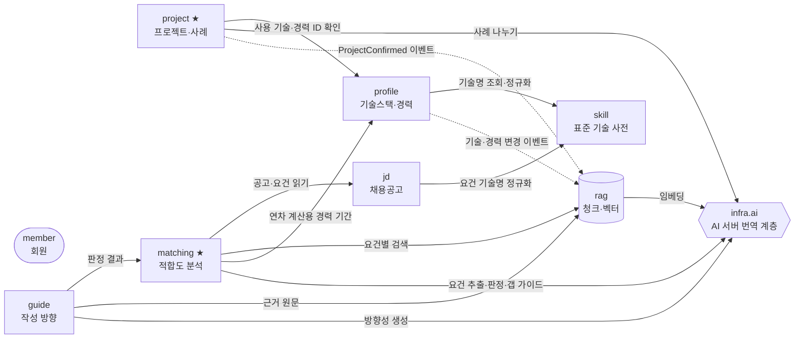
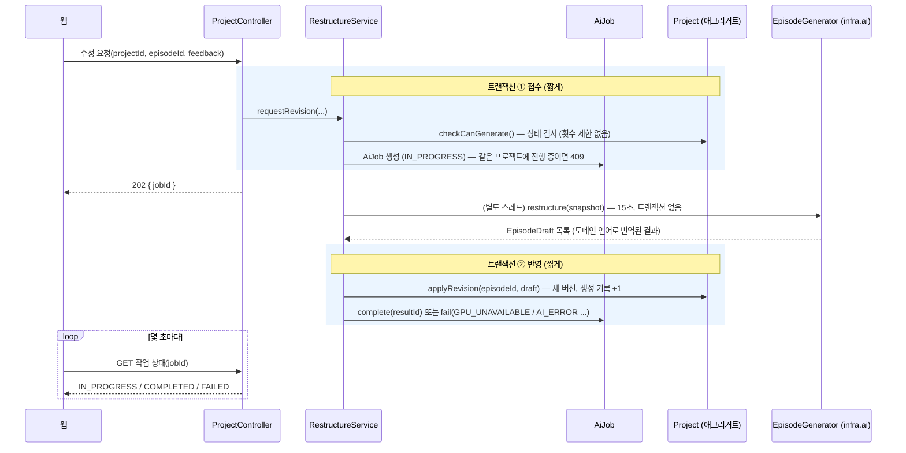

# 01. 개발 방향 — 객체지향 + DDD를 어디까지, 어떻게

> 기준 문서: `SPEC-nerdnam/기획서.md` v1.8, `작업목록.md` · 작성일 2026-10-21
> 다음 문서: [02 도메인 모델](02-도메인-모델.md) · [03 테이블 설계](03-테이블-설계.md) · [04 개발 계획](04-개발-계획.md) · [05 로컬 환경 셋업](05-로컬-환경-셋업.md)

## 1. 한 줄 요약

| 방향 | 내용 |
| --- | --- |
| **모듈러 모놀리스** | 서버(배포 단위)는 하나. 코드 안에서는 기획서의 업무 영역(바운디드 컨텍스트)마다 패키지를 나누고, 패키지 사이의 경계를 규칙으로 지킨다. |
| **DDD는 핵심 도메인에 집중** | 프로젝트·사례(F2)와 적합도 분석(F5)은 규칙이 많으니 풍부한 도메인 모델로 만든다. 기술 사전·RAG 저장·AI 연동은 단순하게 만든다. |
| **실용적인 계층 구조** | 모듈마다 `api → application → domain ← infrastructure`. 의존은 항상 도메인 쪽으로만 향한다. |
| **JPA 엔티티 = 도메인 모델** | 도메인 객체와 JPA 엔티티를 따로 만들지 않는다. 대신 setter를 열지 않고, 상태는 의미 있는 메서드(`confirm()`, `exclude()`)로만 바꾼다. |
| **AI는 바깥 세계** | AI 서버는 "번역 계층"(`infra.ai`) 뒤에 숨긴다. 도메인 코드는 AI 서버 JSON 모양을 모른다. AI 호출 동안 DB 트랜잭션을 잡지 않는다. |

## 2. 왜 이렇게 정했나 (트레이드오프)

혼자서 8주 안에 MVP를 내야 하고, Java·Spring을 처음 쓰는 상황을 기준으로 골랐습니다. "교과서적으로 가장 순수한 DDD"보다 **규칙이 있는 곳에만 공을 들이고 나머지는 단순하게** 가는 쪽입니다.

| 결정 | 대안 | 이렇게 고른 이유 |
| --- | --- | --- |
| 모듈러 모놀리스 | 마이크로서비스 | 이미 웹·API·AI 3개 서버가 있다. API 서버를 더 쪼개면 운영과 트랜잭션 문제만 늘어난다. 나중에 쪼개야 하면 모듈 경계가 그대로 쪼갤 선이 된다. |
| JPA 엔티티를 도메인 모델로 사용 | 순수 도메인 객체 + JPA 엔티티 분리(헥사고날 정석) | 분리하면 모든 객체에 매핑 코드가 두 벌 생긴다. 1인 개발에 과하다. JPA 어노테이션은 "어떻게 저장하나"를 적은 메타데이터로 보고, 규칙은 메서드에 둔다. |
| Spring Data 리포지토리 인터페이스를 `domain` 패키지에 둠 | 도메인 리포지토리 인터페이스 + 별도 구현 클래스 | 구현 클래스를 직접 쓸 일이 거의 없다. 복잡한 조회가 생기면 그때 `infrastructure`에 구현을 추가한다. |
| RAG 모듈은 JPA 대신 `JdbcClient` + SQL | JPA + hibernate-vector | 벡터 거리 연산자(`<=>`), 배열 겹침(`&&`), 하이브리드 점수 합산은 SQL이 가장 읽기 쉽다. 청크는 규칙이 거의 없는 데이터라 엔티티로 만들 이득이 적다. 기획서 5.1도 "검색 SQL을 한 모듈에 모은다"고 정했다. |
| 테이블은 Flyway만 만든다 (`ddl-auto: validate`) | JPA가 테이블 자동 생성(`ddl-auto: update`) | 기획서 4장이 Flyway를 정했다. 자동 생성은 pgvector 타입·CHECK·부분 인덱스를 만들지 못하고, 운영 DB에서 위험하다. |

## 3. 바운디드 컨텍스트와 패키지

기획서 5.2의 패키지 구조를 기본으로 하되, 이름 두 개를 바꾸고 하나를 분리했습니다. 바꾼 이유는 표 아래에 있습니다. **팀과 합의한 뒤 `SPEC-nerdnam/adr/`에 기록하고 기획서 5.2를 고치는 것을 권장합니다.**

| 패키지 | 컨텍스트 (하는 일) | 기획서 5.2 | 도메인 종류 | 모델링 강도 |
| --- | --- | --- | --- | --- |
| `member` | 회원·소셜 로그인·동의·탈퇴 | `auth` | 일반 | 낮음 (Spring Security에 맡김) |
| `skill` | 표준 기술 사전, 기술명 정규화, 자동완성 | `profile` 안 | 지원 | 낮음~중간 |
| `profile` | 내 기술스택, 경력 | `profile` | 지원 | 중간 |
| `project` | 프로젝트, 사례 나누기·버전·확정 | `project` | **핵심** | **높음** |
| `jd` | 채용공고 양식, 분석 전 검증 | `jd` | 지원 | 중간 |
| `matching` | 적합도 분석 흐름, 판정 결합, 리포트 | `application` | **핵심** | **높음** |
| `guide` | 작성 방향, 이미지 프롬프트, 탭별 생성 | `application` | 핵심(AI 비중 큼) | 중간 |
| `rag` | 청크 생성, 벡터 저장, 하이브리드 검색 | `rag` | 지원(기술) | 낮음 (SQL 중심) |
| `aijob` | AI 작업 상태(웹 폴링), 같은 대상 동시 1건 잠금 | — (v1.11 제안으로 추가) | 지원 | 낮음 |
| `infra.ai` | AI 서버 호출, 요청·응답 번역 | `infra/ai` | — | 부패 방지 계층 |
| `common` | 공통 기반 코드 (시간 컬럼, 오류 응답) | — | — | 도메인 개념 두지 않음 |

- **`auth` → `member`:** "인증"은 기술 이름이고, 업무에서 다루는 대상은 "회원"이다. 로그인 설정 코드는 `member` 안의 `infrastructure`에 둔다.
- **`application` → `matching` + `guide`:** DDD에서 `application`은 "계층" 이름(유스케이스 계층)이라, 모듈 이름으로 쓰면 `application.application` 같은 패키지가 생겨 헷갈린다. 또 적합도 분석과 작성 방향은 생명주기(저장 단위, 재생성 규칙)가 달라 나눈다.
- **`skill` 분리:** 기술 사전은 기술스택(S02)과 공고 요건 정규화(F4)가 함께 쓰는 공용 사전이다. `profile` 안에 두면 `jd`가 `profile` 내부를 참조하게 된다.

### 컨텍스트 사이의 관계



실선은 직접 호출(상대 모듈의 application 서비스를 부름), 점선은 도메인 이벤트입니다. 모든 데이터는 `memberId`로 회원에 묶이므로 `member`로 가는 선은 생략했습니다.

## 4. 모듈 안의 구조

모든 모듈이 같은 모양을 가집니다. 모듈이 작으면(`skill`, `rag`) 빈 폴더는 만들지 않아도 됩니다.

```text
com.nerdnam.project
├── api/              # 컨트롤러, 요청·응답 DTO (웹과의 계약 = web-api.openapi.yaml)
├── application/      # 유스케이스 서비스, 커맨드, @Transactional 경계, 포트(외부 의존 인터페이스)
├── domain/           # 애그리거트·엔티티·값 객체·도메인 이벤트·리포지토리 인터페이스
└── infrastructure/   # 포트 구현 (AI 어댑터, 복잡한 조회 쿼리)
```

### 의존 규칙 (이것만은 지킨다)

1. **`domain`은 바깥을 모른다.** 컨트롤러 DTO, HTTP, 다른 모듈의 `domain` 클래스를 import하지 않는다. 허용하는 것은 JPA 어노테이션과 Spring Data 리포지토리 인터페이스뿐이다.
2. **다른 애그리거트는 ID로만 참조한다.** `@ManyToOne`, `@OneToMany` 같은 JPA 연관관계는 **같은 애그리거트 안에서만** 쓴다. 예: `Project`는 `Career` 객체가 아니라 `Long careerId`를 가진다.
3. **다른 모듈은 그 모듈의 `application` 서비스를 통해서만 부른다.** 다른 모듈의 리포지토리를 직접 주입받지 않는다.
4. **다른 모듈의 변화에 반응할 때는 도메인 이벤트를 쓴다.** 예: 프로젝트 확정 → `ProjectConfirmed` → `rag`가 청크 등록.
5. **컨트롤러는 엔티티를 그대로 내보내지 않는다.** 항상 응답 DTO(`record`)로 바꾼다. 엔티티를 그대로 내보내면 지연 로딩 오류와 내부 필드 노출이 생긴다.

이 규칙은 사람의 기억에 맡기지 않고 테스트로 검사합니다. 묶음 1이 끝날 때 [Spring Modulith](https://docs.spring.io/spring-modulith/reference/)의 `ApplicationModules.of(NerdnamApplication.class).verify()` 테스트를 추가합니다 (04 개발 계획 참고).

## 5. 애그리거트를 설계하는 규칙

애그리거트는 "**한 번에 같이 바뀌어야 하고, 같이 규칙을 지켜야 하는 객체 묶음**"입니다. 묶음 바깥에서는 루트(대표 객체)만 만질 수 있습니다.

| 규칙 | nerdnam에서의 예 |
| --- | --- |
| 루트를 통해서만 내부를 바꾼다 | `episode.confirm()`을 직접 부르지 않고 `project.confirmEpisode(episodeId)`를 부른다. 루트가 "프로젝트가 이미 확정됐는지", "확인 필요가 남았는지"를 검사할 수 있게. |
| 규칙(불변식)은 루트의 메서드 안에서 검사한다 | "모든 사례를 결정하고 확정한 사례가 1개 이상이어야 프로젝트 확정"은 `Project.confirm()` 안에 있다. 서비스 계층에 if문으로 흩어 두지 않는다. |
| 트랜잭션 하나에서 애그리거트 하나만 바꾼다 | 프로젝트 확정과 청크 등록은 다른 트랜잭션. 둘을 이어주는 것은 이벤트. |
| 작게 만든다 | 기술스택은 회원당 하나의 큰 `TechStack`이 아니라 기술 하나하나(`UserSkill`)가 애그리거트. 중복 금지는 DB 유니크 제약으로 지킨다. |
| 동시 수정은 낙관적 락으로 막는다 | 루트에 `@Version`. 두 탭에서 같은 프로젝트를 고치면 늦게 저장한 쪽이 409 응답을 받는다. |

## 6. JPA 코딩 규칙 (자주 하는 실수 방지)

| 규칙 | 이유 |
| --- | --- |
| `@Setter`, `@Data` 금지. `@Getter`와 `@NoArgsConstructor(access = AccessLevel.PROTECTED)`만 | 아무 데서나 값을 바꾸면 규칙을 우회한다. JPA는 기본 생성자가 필요하지만 외부에서 쓰지 못하게 `protected`로. |
| 생성은 정적 팩토리 메서드 (`Project.createDraft(...)`) | 생성 시점의 규칙 검사와 초기 상태 설정을 한곳에. |
| enum은 `@Enumerated(EnumType.STRING)` | 기본값(ORDINAL)은 숫자로 저장돼 enum 순서를 바꾸면 데이터가 깨진다. DB CHECK 값과 enum 이름을 똑같이 맞춘다. |
| 연관관계는 모두 `fetch = LAZY` | `@ManyToOne` 기본값은 EAGER라 생각지 못한 조인이 생긴다. |
| 애그리거트 내부 컬렉션은 `cascade = ALL, orphanRemoval = true` | 루트를 저장하면 자식도 같이 저장되고, 목록에서 빼면 DB에서도 지워진다. 애그리거트 바깥 관계에는 절대 쓰지 않는다. |
| 컬렉션 getter는 수정 불가 뷰를 돌려준다 | `project.getEpisodes().add(...)`로 규칙을 우회하지 못하게 `Collections.unmodifiableList(...)`. |
| `@Transactional`은 `application` 서비스에만, 조회는 `readOnly = true` | 트랜잭션 경계가 한 계층에 모여야 읽기 쉽다. |
| `open-in-view: false` (설정 완료) | 컨트롤러에서 지연 로딩이 일어나지 않는다. 대신 서비스 안에서 DTO로 바꿔 돌려준다. |
| 목록 조회 N+1 주의 | 처음엔 `default_batch_fetch_size: 100`(설정 완료)로 막고, 필요한 곳만 fetch join이나 `@EntityGraph`. 개발 중에는 SQL 로그(local 프로필에서 켜짐)를 보는 습관을 들인다. |
| jsonb 컬럼은 `@JdbcTypeCode(SqlTypes.JSON)` + `record` 목록 | 예: `List<Metric> metrics`. 처음 쓸 때 저장·조회 테스트로 직렬화가 되는지 꼭 확인한다 (Spring Boot 4는 Jackson 3을 기본으로 쓰므로, Hibernate 쪽 JSON 매핑 설정이 필요한지 이때 확인). |
| JSON 값 이름은 계약을 따른다 | DB·Java enum은 대문자(`LANGUAGE`, `MET`), API 계약은 소문자(`language`, `met`, 기획서 4.1·D-10)일 수 있다. 응답 DTO에서 바꾸고, 엔티티를 JSON으로 직접 내보내지 않는다. |
| `YearMonth`(YYYY-MM)는 `AttributeConverter`로 `date`(그 달 1일)에 저장 | 경력·프로젝트 기간. DB에는 1일만 들어가도록 CHECK가 걸려 있다. |

## 7. AI 호출과 트랜잭션 — 가장 중요한 실무 포인트

AI 호출은 15~60초 걸립니다(기획서 8장 성능 목표). 두 가지를 지킵니다.

1. **AI 호출 동안 DB 트랜잭션을 잡지 않는다.** 트랜잭션을 열어 두면 커넥션 풀(기본 10개)이 금방 바닥나 서버 전체가 멈춘다. 그래서 "접수(짧은 트랜잭션) → AI 호출(트랜잭션 밖) → 반영(짧은 트랜잭션)"으로 나눈다.
2. **웹 요청은 AI를 기다리지 않는다** (기획서 v1.11 제안). 웹 요청은 작업을 접수하고 작업 id만 바로 돌려준다(`202 Accepted`). 웹은 그 id로 몇 초마다 상태를 묻는다(폴링). 새로고침하거나 화면을 나갔다 와도 이어서 기다릴 수 있다.



- **동시 1건 잠금 (ADR-0002):** `app.ai_job`의 부분 유니크 인덱스(`target_type, target_id, lock_scope` 중 `IN_PROGRESS`는 하나만)가 막는다. 두 번째 요청은 유니크 위반 → `409`와 함께 진행 중인 작업 id를 돌려준다. 작성 방향은 탭 이름을 `lock_scope`로 써서 탭끼리는 동시에 돌 수 있다.
- **별도 스레드 실행:** 처음에는 Spring `@Async` + 전용 실행기(스레드 수 제한)로 충분하다. 서버가 작업 도중 재시작되면 작업이 `IN_PROGRESS`로 남으므로, 일정 시간(예: 3분) 넘게 진행 중인 작업은 정기 작업이 `FAILED(TIMEOUT)`으로 바꾼다.
- **실패 이유 구분:** GPU 서버가 꺼져 있으면 `GPU_UNAVAILABLE`, 그 밖의 AI 오류는 `AI_ERROR`. 웹은 이 값으로 "잠시 후 다시 시도해 주세요"를 띄운다 (기획서 8장, ADR-0001).
- **생성 횟수**에는 상한이 없다 (ADR-0002). 통계용 기록이라 결과를 반영할 때만 올린다.
- ①과 ② 사이에 사용자가 다른 화면에서 같은 프로젝트를 고쳤다면 `@Version` 충돌이 난다. 이때는 작업을 `FAILED`로 끝내고 웹이 화면을 다시 불러오게 한다.
- **작성 방향(`/guide`)은 API↔AI 사이만 스트리밍**이다. API는 AI 서버의 스트림을 받아 끝까지 모은 뒤 탭 결과를 저장하고, 웹에는 중계하지 않는다 (기획서 v1.11 5.4).

## 8. 도메인 이벤트

| 방식 | 쓰는 곳 |
| --- | --- |
| 애그리거트 루트가 `AbstractAggregateRoot`를 상속하고 `registerEvent(...)`로 이벤트를 모은다 → 리포지토리 `save()` 때 Spring이 발행 | 이벤트를 만드는 쪽 |
| `@TransactionalEventListener(phase = AFTER_COMMIT)` | 받는 쪽. 커밋된 뒤에만 실행되어, 롤백된 확정 때문에 청크가 등록되는 일이 없다. |

주의: 커밋 후 리스너에서 임베딩(AI 호출)이 실패하면 이벤트가 사라집니다. 확정한 사례가 검색에 안 나오는 문제가 조용히 생기므로, 묶음 1 안에서 **Spring Modulith의 이벤트 발행 기록(Event Publication Registry)** 을 붙여 실패한 이벤트를 DB에 남기고 재시도하는 것을 권장합니다. (04 개발 계획 묶음 1의 BE-10)

## 9. 테스트 전략

| 층 | 무엇을 | 도구 | 양 |
| --- | --- | --- | --- |
| 도메인 단위 테스트 | 불변식·상태 전이. "확인 필요가 남은 사례는 확정할 수 없다" | JUnit 5 + AssertJ, Spring 없이 | **가장 많이** |
| 저장 테스트 | 엔티티 매핑, jsonb, 제약 조건, 조회 쿼리 | Testcontainers PostgreSQL(pgvector) | 리포지토리마다 몇 개 |
| 서비스 통합 테스트 | 유스케이스 흐름, 트랜잭션, 이벤트 | `@SpringBootTest` + AI 스텁(고정 응답, `fixtures/`) | 유스케이스마다 1~2개 |
| API 테스트 | 요청 검증, 오류 응답 형식, 소유권 검사 | MockMvc | 엔드포인트마다 |
| 구조 테스트 | 모듈 경계 위반 | Spring Modulith `verify()` | 1개 |

- **H2(메모리 DB)는 쓰지 않는다.** jsonb, vector, 스키마, CHECK가 PostgreSQL과 달라 "테스트는 통과했는데 실제로는 깨지는" 일이 생긴다. Testcontainers는 Docker로 진짜 PostgreSQL을 띄운다.
- 예시는 이미 들어 있다: `SkillNameKeyTest`(도메인 단위), `NerdnamApplicationTests`(Flyway·pgvector 통합).

## 10. 보안·개인정보 기본값 (기획서 8장)

- **소유권 검사를 기본으로:** 리포지토리 조회는 `findByIdAndMemberId(id, memberId)` 모양으로 만든다. "없음"과 "남의 것"을 구분하지 않고 둘 다 404로 응답한다 (남의 데이터 존재 여부를 알려주지 않기 위해).
- **RAG 검색 메서드는 `memberId`를 필수 파라미터로 받는다.** SQL에 `WHERE member_id = :memberId`가 빠질 수 없는 시그니처로 만든다.
- **AI 서버에는 식별 정보를 보내지 않는다.** 이름·이메일·회사명 대신 청크 ID와 텍스트만 (기획서 5.5). AI 응답의 청크 ID는 다시 이 회원의 것인지 확인한다.
- **탈퇴 = `member` 행 삭제.** 모든 테이블이 `ON DELETE CASCADE`로 연결되어 원본과 벡터가 한 번에 지워진다 (로컬 PostgreSQL에서 확인함). Redis 캐시는 탈퇴 이벤트에서 따로 지운다.
