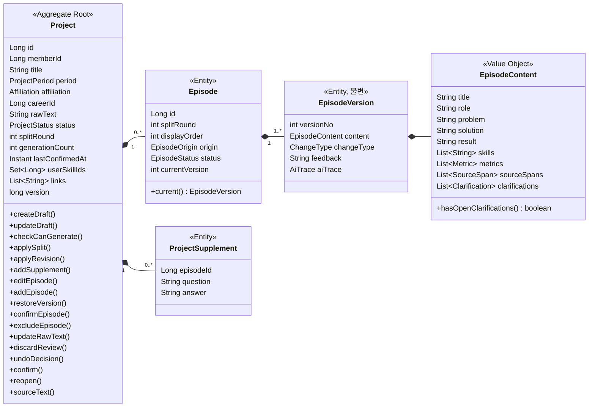
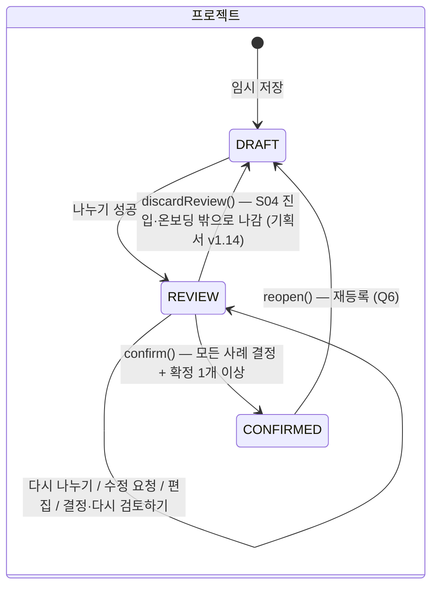
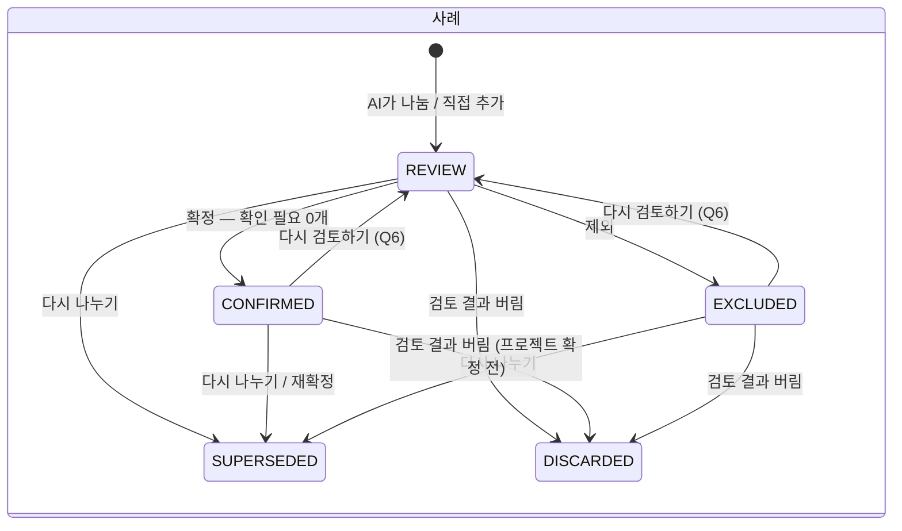
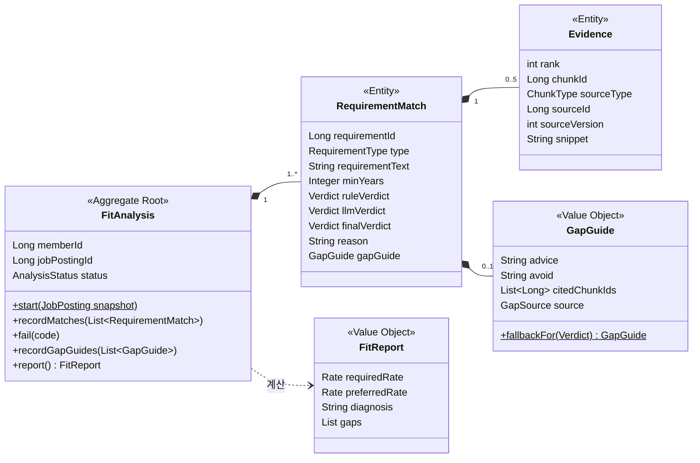

# 02. 도메인 모델

> 기획서 2·3·4장을 객체로 옮긴 결과입니다. 테이블은 [03 테이블 설계](03-테이블-설계.md)에 있습니다.

## 1. 유비쿼터스 언어 (용어집)

화면·기획서·코드·DB·API가 **같은 말을 쓰도록** 하는 표입니다. 새 클래스나 컬럼 이름을 지을 때 먼저 여기서 찾고, 없으면 여기에 추가합니다.

| 화면·기획서 | 코드 이름 | 뜻 |
| --- | --- | --- |
| 회원 | `Member` | 서비스 사용자. 모든 데이터의 주인 |
| 표준 기술 사전 | `Skill`, `SkillAlias` | 전체 사용자 공용 기술 목록과 별칭 (react.js, 리액트 → React) |
| 정규화 키 | `SkillNameKey` | 기술명을 비교하기 위한 키. 소문자 + 공백 제거 |
| 기술스택 (항목) | `UserSkill` | 회원이 가진 기술 하나 + 숙련도 |
| 숙련도 | `Proficiency` | `LEARNING`(학습 중) / `WORKING`(실무 사용) / `PROFICIENT`(능숙) / `EXPERT`(전문가) = 1~4 |
| 경력 | `Career` | 회사 한 곳의 재직 기록 |
| 재직기간 | `EmploymentPeriod` | 시작 월 ~ 종료 월(없으면 재직 중) |
| 프로젝트 | `Project` | 사용자가 자유 텍스트로 쓴 경험 하나 |
| 원문 | `rawText` | 사용자가 쓴 프로젝트 본문 그대로 |
| 보충 답변 | `ProjectSupplement` | 확인 질문에 사용자가 답한 내용. 원문 뒤에 덧붙여 AI에 보낸다 |
| 사례 (에피소드) | `Episode` | 프로젝트 안의 [문제]-[해결]-[결과] 이야기 하나 |
| 사례 버전 | `EpisodeVersion` | 사례 내용의 한 시점 (v1, v2 …). 한 번 만들면 바뀌지 않는다 |
| 확인 필요 | `Clarification` | AI가 원문에서 찾지 못해 사용자에게 묻는 질문 (기획서의 `unverified`) |
| 나누기 / 다시 나누기 | `split` / `resplit` | AI가 프로젝트를 사례 N개로 나누기 |
| 수정 요청 | `requestRevision` | 사례 하나를 자연어 피드백으로 다시 만들기 |
| 직접 편집 / 사례 직접 추가 | `editEpisode` / `addEpisode` | AI 없이 사용자가 고치기·추가 |
| 이 버전으로 바꾸기 (되돌리기) | `restoreVersion` | 이전 버전 내용을 복사해 새 최신 버전으로 만들기. 사례 상태는 그대로 (화면 이름, 기획서 v1.11) |
| 다시 검토하기 (결정 취소) | `undoDecision` | 확정·제외한 사례를 검토 중으로 (화면 이름, 기획서 v1.11) |
| 확정 / 제외 | `confirm` / `exclude` | 사례·프로젝트의 결정 |
| AI 작업 | `AiJob` | 재구성·적합도 분석·작성 방향 탭 생성 1건. 웹은 작업 id로 상태를 조회한다 (기획서 v1.11 제안) |
| 생성 횟수 | `generationCount` | 프로젝트 단위 AI 생성 누적 횟수. **상한 없음** — 통계(KPI)·비용 측정용 |
| 나누기 회차 | `splitRound` | 첫 나누기 = 1, 다시 나누기마다 +1. 사례가 몇 번째 나누기에서 나왔는지 구분 |
| 편집 다시 시작 (재등록) | `reopen` | 확정한 프로젝트를 고치기 위해 등록 과정 전체를 다시 시작. 기존 내용은 맥락으로 남는다 |
| 공고 (JD) | `JobPosting` | 사용자가 양식에 옮겨 적은 채용공고 |
| 요건 (필수/우대) | `Requirement` (`REQUIRED`/`PREFERRED`) | 공고의 한 줄 요건 |
| 주요 업무 | `PostingTask` | 공고의 업무 한 줄 (지원동기용) |
| 적합도 분석 | `FitAnalysis` | 공고 하나에 대한 분석 1회 |
| 요건 판정 | `RequirementMatch` | 요건 하나의 판정 결과 |
| 판정 | `Verdict` | `MET`(충족) / `PARTIAL`(부분 충족) / `UNMET`(미충족) |
| 근거 | `Evidence` | 판정을 뒷받침하는 청크와 원본 출처 |
| 작성 방향 | `WritingGuide` | 탭 하나의 AI 생성 결과 |
| 탭 | `GuideTab` | `MOTIVATION` 지원동기 / `SELF_INTRODUCTION` 자기소개 / `PORTFOLIO` 포트폴리오 / `CAREER_DESCRIPTION` 경력기술서 / `IMAGE_PROMPT` 이미지 프롬프트 |
| 청크 | `Chunk` | 검색 단위 텍스트 + 벡터 (`SKILL`, `CAREER`, `PROJECT_SUMMARY`, `EPISODE`) |

## 2. 애그리거트 한눈에 보기

| 모듈 | 애그리거트 루트 | 안에 들어 있는 것 | 값 객체 | 다른 애그리거트 참조 (ID) |
| --- | --- | --- | --- | --- |
| member | `Member` | `SocialAccount`, `MemberConsent` | — | — |
| skill | `Skill` | `SkillAlias` | `SkillNameKey`, `SkillCategory` | — |
| profile | `UserSkill` | — | `Proficiency` | memberId, skillId |
| profile | `Career` | 주요 업무 줄 목록, 사용 기술 ID 목록 | `EmploymentPeriod`, `EmploymentType` | memberId, userSkillId[] |
| **project** | **`Project`** | **`Episode` → `EpisodeVersion`**, `ProjectSupplement`, 링크 목록, 사용 기술 ID 목록 | `ProjectPeriod`, `Affiliation`, `EpisodeContent`, `Metric`, `SourceSpan`, `Clarification` | memberId, careerId, userSkillId[] |
| jd | `JobPosting` | `Requirement`, 주요 업무 줄 목록 | `RequirementType`, `PostingViolation` | memberId |
| **matching** | **`FitAnalysis`** | `RequirementMatch` → `Evidence` | `Verdict`, `FitReport` | memberId, jobPostingId |
| guide | `WritingGuide` | — | `GuideTab` | fitAnalysisId |
| aijob | `AiJob` | — | `JobType`, `JobStatus`, `FailureCode` | memberId, 대상(target_type + target_id) |
| rag | (애그리거트 아님) `Chunk` | — | `ChunkType` | memberId, sourceId |

## 3. 핵심 도메인 ① — Project 애그리거트

기획서에서 규칙이 가장 많은 곳입니다(F2). 이 애그리거트를 제대로 만들면 나머지는 같은 패턴의 반복입니다.

### 3.1 구조



- `EpisodeContent`는 [문제]-[해결]-[결과]와 메타정보를 묶은 **값 객체**입니다. 같은 내용이면 같은 것으로 보고, 바뀌면 새 객체(= 새 버전)를 만듭니다.
- `EpisodeVersion`은 한 번 저장하면 고치지 않습니다(append-only). **"이 버전으로 바꾸기"(되돌리기)도 고른 버전을 복사해 새 최신 버전(`RESTORED`)으로 쌓습니다.** 그래서 현재 버전은 항상 가장 최신 버전이고, 기록은 한 방향으로만 늘어납니다. FE 디자인(`review.js`)도 이 방식이라 맞췄습니다 (C-02 S05 확인할 것 1). 복사하므로 v1의 확인 필요 질문도 그대로 되살아납니다 (확인할 것 2).
- 원문(`rawText`)과 보충 답변(`ProjectSupplement`)을 따로 저장하고, AI에 보낼 때 `sourceText()`가 "원문 + 보충 답변"을 순서대로 이어 붙입니다. 뒤에만 붙이므로 기존 `sourceSpans`의 위치가 어긋나지 않고, 사용자가 쓴 원문은 항상 그대로 남습니다 (기획서 4.3 "raw_text는 항상 보관").

### 3.2 상태 전이





`SUPERSEDED`(대체됨)는 다시 나누기를 하면 기존 사례를 지우는 대신 남겨 두는 상태입니다. 재등록할 때 AI에 보내는 "이전 내용 맥락", KPI(사례 제외율, 재구성 횟수), 추후 회차 비교 기능의 재료가 됩니다. 화면에는 보여주지 않습니다. (기획서 v1.10 4.3에 반영)

### 3.2-1 재등록 (확정 후 수정, ADR-0002)

확정한 프로젝트를 고치려면 **등록 과정 전체를 다시** 거칩니다. 기존 내용은 지우지 않고 맥락으로 남깁니다.

| 순서 | 일어나는 일 | 도메인 |
| --- | --- | --- |
| 1 | S06 "편집" → 재등록 시작 | `reopen()`: `CONFIRMED → DRAFT`. 원문·사용 기술·링크·보충 답변은 그대로 (입력 화면에 채워짐). `lastConfirmedAt`은 남아 "확정본 있음"을 뜻한다 |
| 2 | 입력 수정 후 나누기 | `applySplit()`: `splitRound + 1`, 새 회차 사례 생성. 재등록 전 확정본은 그대로 두고 AI 입력에 맥락으로 넣는다. 검토를 그만두면(`discardReview()`) 이번 회차만 버려지고 확정본은 남는다 |
| 3' | 다시 확정 | 이번 회차 확정 → 재등록 전 확정본은 `SUPERSEDED` |
| 3 | 사례별 결정 → 확정 | 일반 흐름과 같음. 확정 시 `ProjectConfirmed` |
| 4 | 청크 교체 | rag가 그 프로젝트의 청크(`project_id`)를 새 확정 사례 기준으로 통째로 교체 |
| — | 1~3 사이 | 이전 확정 사례의 청크는 검색에 계속 쓰인다 (Q4). S06에 "재등록 중" 표시 |

남은 질문: 재등록을 도중에 그만두고 이전 확정본으로 돌아가는 "재등록 취소"를 MVP에 넣을지 (ADR-0002 남은 질문).

### 3.3 불변식 (깨지면 안 되는 규칙)

| ID | 규칙 | 기획서 근거 | 지키는 곳 |
| --- | --- | --- | --- |
| P1 | 프로젝트 확정: 이번 회차 사례가 모두 `CONFIRMED` 또는 `EXCLUDED`이고, `CONFIRMED`가 1개 이상. 확정하면 이전 회차의 확정 사례(재등록 전 확정본)는 `SUPERSEDED` | F2 상태, 4.3 | `Project.confirm()` |
| P2 | 사례 확정: 현재 버전에 확인 필요 질문이 남아 있지 않음 | F2, 4.3 `unverified` | `Project.confirmEpisode()` |
| P3 | AI 생성(나누기·다시 나누기·수정 요청·확인 답변 반영)은 **횟수 제한 없음**. `generationCount`는 기록만 한다. 같은 프로젝트의 AI 요청은 동시에 1건만 | ADR-0002 Q1~Q3 | `Project.applySplit()/applyRevision()` (기록), 서비스의 동시 실행 잠금 |
| P4 | 다시 나누기를 하면 **이번 회차** 사례는 모두 `SUPERSEDED`, 결정은 초기화, `splitRound + 1`. 재등록 전 확정본은 그대로 둔다(다시 확정할 때까지 검색에 쓰이고 AI 맥락이 됨) | F2, D-2 | `Project.applySplit()` |
| P5 | 사례 버전은 사례마다 1부터 1씩 증가하고, 만든 버전은 바꾸지 않는다 | 4.3 `version` | `Episode.addVersion()` |
| P6 | "이 버전으로 바꾸기"는 이미 있는 버전으로만, 고른 내용을 복사한 새 버전(`RESTORED`)을 만들고 사례 상태는 바꾸지 않는다 | F2, 기획서 v1.11 | `Project.restoreVersion()` |
| P7 | 확정된 프로젝트의 사례는 바꿀 수 없다. 고치려면 재등록(`reopen()`)부터 | Q6 | 모든 변경 메서드 앞의 `ensureNotConfirmed()` |
| P7-1 | **검토 결과 유지 규칙** (기획서 v1.14, ADR-0002 Q5 변경): 확정 전 검토 결과(이번 회차 사례·결정·버전·확인 답변)는 S04에 들어가거나 S05에서 온보딩 밖으로 나가면 버린다 → 이번 회차 사례 `DISCARDED`, 프로젝트 `DRAFT`. 버린 사례의 확인 답변은 원문 조합(`sourceText()`)에서 빠진다. 그래서 원문 수정은 `DRAFT`에서만 일어난다 | 기획서 F2 | `Project.discardReview()`, `updateRawText()` |
| P7-2 | 다시 검토하기(결정 취소, 확정·제외 → 검토 중)는 프로젝트 확정 전에만 | Q6 | `Project.undoDecision()` |
| P7-3 | 확정·제외한 사례는 내용을 바꿀 수 없다. 다시 검토하기로 검토 중으로 되돌린 뒤 고친다 | 기획서 v1.17 | `editableEpisode()` (모든 내용 변경 메서드) |
| P8 | 소속이 경력(`CAREER`)이면 `careerId`가 있어야 한다 | F1 | `Project.createDraft()/updateDraft()` |
| P9 | AI가 돌려준 사례의 사용 기술은 프로젝트 사용 기술 안에 있어야 한다 | F2 "원문에 없는 사실 금지" | `applySplit()/applyRevision()` (벗어나면 제외하고 기록) |

### 3.4 유스케이스 → 루트 메서드

| 유스케이스 (화면) | 서비스 | 루트 메서드 | 생성 횟수 | 이벤트 |
| --- | --- | --- | --- | --- |
| 프로젝트 임시 저장 (S04) | `ProjectDraftService` | `createDraft()`, `updateDraft()` | — | — |
| 사례 나누기 (S04 → S05) | `RestructureService` | `checkCanGenerate()` → AI → `applySplit()` | 기록 +1 | — |
| 다시 나누기 (S05) | `RestructureService` | `checkCanGenerate()` → AI → `applySplit()` | 기록 +1 | — |
| 수정 요청 (S05) | `RestructureService` | `checkCanGenerate()` → AI → `applyRevision()` | 기록 +1 | — |
| 확인 질문에 답하기 (S05) | `RestructureService` | `addSupplement()` → AI → `applyRevision()` | 기록 +1 | — |
| 직접 편집 / "빼고 진행" (S05) | `EpisodeDecisionService` | `editEpisode()` | — | — |
| 사례 직접 추가 (S05) | `EpisodeDecisionService` | `addEpisode()` | — | — |
| 이 버전으로 바꾸기 (S05) | `EpisodeDecisionService` | `restoreVersion()` | — | — |
| 사례 확정 / 제외 / 다시 검토하기 (S05) | `EpisodeDecisionService` | `confirmEpisode()`, `excludeEpisode()`, `undoDecision()` | — | — |
| 프로젝트 확정 (S05) | `ProjectConfirmService` | `confirm()` | — | `ProjectConfirmed` |
| 재등록 시작 (S06 편집) | `ProjectDraftService` | `reopen()` | — | `ProjectReopened` |

`checkCanGenerate()`는 이제 "확정된 프로젝트가 아닌지"만 검사합니다 (상한 없음). 생성 횟수는 상한이 아니라 기록이라 "기록 +1"로 적었습니다.

### 3.5 코드 스케치

실제 구현의 출발점입니다. 그대로 복사하기보다 **도메인 단위 테스트를 먼저 쓰고**(04 개발 계획의 구현 순서) 이 모양을 채워 가세요.

```java
@Entity
@Table(name = "project")
@Getter
@NoArgsConstructor(access = AccessLevel.PROTECTED)
public class Project extends AbstractAggregateRoot<Project> {   // registerEvent() 사용

    @Id @GeneratedValue(strategy = GenerationType.IDENTITY)
    private Long id;
    private Long memberId;
    private String title;
    @Enumerated(EnumType.STRING) private Affiliation affiliation;
    private Long careerId;                                // 다른 애그리거트는 ID로만
    private String rawText;
    @Enumerated(EnumType.STRING) private ProjectStatus status;
    private int splitRound;                               // 나누기 회차
    private int generationCount;                          // 기록용. 상한 없음 (ADR-0002)
    private Instant lastConfirmedAt;                      // 확정본이 있는가 (재등록 중에도 유지)
    @Version private long version;

    @OneToMany(mappedBy = "project", cascade = CascadeType.ALL, orphanRemoval = true)
    @OrderBy("displayOrder")
    private List<Episode> episodes = new ArrayList<>();

    public static Project createDraft(Long memberId, String title, Affiliation affiliation,
                                      Long careerId, String rawText) {
        if (affiliation == Affiliation.CAREER && careerId == null) {
            throw new BusinessException(ErrorCode.INVALID_INPUT, "연결할 경력을 선택해 주세요.");
        }
        Project p = new Project();
        p.memberId = memberId;
        p.title = title;
        p.affiliation = affiliation;
        p.careerId = careerId;
        p.rawText = rawText;
        p.status = ProjectStatus.DRAFT;
        return p;
    }

    /** AI 호출 전에 부른다. 트랜잭션 ①. 횟수 제한은 없고 상태만 검사한다 */
    public void checkCanGenerate() {
        ensureNotConfirmed();
    }

    /** 원문 수정 — 검토 중(REVIEW)이면 먼저 검토 결과를 버려야 한다 (P7-1) */
    public void updateRawText(String newRawText) {
        if (status != ProjectStatus.DRAFT) {
            throw new BusinessException(ErrorCode.DOMAIN_RULE_VIOLATED, "검토 중인 결과를 정리한 뒤 본문을 고칠 수 있어요.");
        }
        rawText = newRawText;
    }

    /** 확정 전 검토 결과 버리기 — S04 진입·온보딩 밖으로 나갈 때 웹이 경고 후 호출 (P7-1) */
    public void discardReview() {
        if (status != ProjectStatus.REVIEW) {
            return;                                       // 버릴 것이 없으면 아무 일도 하지 않는다 (여러 번 불러도 안전)
        }
        currentRoundEpisodes().forEach(Episode::discard);
        status = ProjectStatus.DRAFT;                     // 재등록 중이었다면 이전 확정본은 그대로
    }

    /** 나누기·다시 나누기 결과 반영 — P3, P4. 트랜잭션 ② */
    public void applySplit(List<EpisodeContent> drafts, AiTrace trace) {
        checkCanGenerate();                               // ①과 ② 사이에 확정됐을 수 있으니 다시 검사
        currentRoundEpisodes().forEach(Episode::supersede); // P4: 이번 회차만 "대체됨"으로. 재등록 전 확정본은 그대로
        splitRound++;
        for (EpisodeContent draft : drafts) {
            episodes.add(Episode.fromAi(this, splitRound, nextDisplayOrder(), draft, trace));
        }
        generationCount++;                                // 기록만
        status = ProjectStatus.REVIEW;
    }

    /** P2 */
    public void confirmEpisode(Long episodeId) {
        ensureNotConfirmed();
        Episode episode = currentRoundEpisode(episodeId);
        if (episode.current().content().hasOpenClarifications()) {
            throw new BusinessException(ErrorCode.DOMAIN_RULE_VIOLATED,
                    "확인 필요 항목에 답하거나 빼야 확정할 수 있어요.");
        }
        episode.confirm();
    }

    /** P7-2 다시 검토하기(결정 취소) — 프로젝트 확정 전에만 */
    public void undoDecision(Long episodeId) {
        ensureNotConfirmed();
        currentRoundEpisode(episodeId).backToReview();
    }

    /** P1 */
    public void confirm() {
        ensureNotConfirmed();
        List<Episode> active = currentRoundEpisodes();
        boolean allDecided = active.stream().allMatch(Episode::isDecided);
        boolean anyConfirmed = active.stream().anyMatch(Episode::isConfirmed);
        if (!allDecided || !anyConfirmed) {
            throw new BusinessException(ErrorCode.DOMAIN_RULE_VIOLATED,
                    "모든 사례를 확정하거나 제외하고, 1개 이상 확정해야 해요.");
        }
        previousConfirmedEpisodes().forEach(Episode::supersede); // 재등록이었다면 이전 확정본을 새 확정본으로 대체
        status = ProjectStatus.CONFIRMED;
        lastConfirmedAt = Instant.now();
        registerEvent(new ProjectConfirmed(id, memberId));
    }

    /** 재등록 시작 — Q6. 내용은 지우지 않는다 (다음 나누기의 맥락) */
    public void reopen() {
        if (status != ProjectStatus.CONFIRMED) {
            throw new BusinessException(ErrorCode.DOMAIN_RULE_VIOLATED, "확정된 프로젝트만 다시 등록할 수 있어요.");
        }
        status = ProjectStatus.DRAFT;                     // 입력 화면부터 다시. 이전 청크는 다시 확정할 때까지 검색에 쓰인다
        registerEvent(new ProjectReopened(id, memberId));
    }

    /** 재등록 때 AI에 보낼 이전 확정 사례 (맥락) */
    public List<EpisodeContent> previouslyConfirmedContents() {
        return previousConfirmedEpisodes().stream()
                .map(e -> e.current().content())
                .toList();
    }

    public List<Episode> getEpisodes() {                  // 밖에서 목록을 바꾸지 못하게
        return Collections.unmodifiableList(episodes);
    }

    /** 이번 나누기 회차에서 검토 중인 사례 (대체·버림 제외) */
    private List<Episode> currentRoundEpisodes() {
        return episodes.stream()
                .filter(e -> e.getSplitRound() == splitRound && e.isInReview())
                .toList();
    }

    /** 재등록 전에 확정했던 사례 (이전 회차, 아직 CONFIRMED) */
    private List<Episode> previousConfirmedEpisodes() {
        return episodes.stream()
                .filter(e -> e.getSplitRound() < splitRound && e.isConfirmed())
                .toList();
    }

    private void ensureNotConfirmed() {                   // P7
        if (status == ProjectStatus.CONFIRMED) {
            throw new BusinessException(ErrorCode.DOMAIN_RULE_VIOLATED, "확정된 프로젝트예요. 다시 등록을 시작한 뒤 수정해 주세요.");
        }
    }
    // currentRoundEpisode(), nextDisplayOrder(), applyRevision(), restoreVersion(), editEpisode(), addEpisode() ... 생략
}
```

이 스케치에서 볼 것:

- 서비스에 `if (project.getStatus() == ...)`가 없습니다. 규칙은 전부 `Project` 안에 있고, 서비스는 "불러오기 → 메서드 호출 → 저장"만 합니다.
- 예외 메시지는 화면에 그대로 보여줄 수 있는 문장입니다.
- 회차(`splitRound`)로 "이번 검토"와 "재등록 전 확정본"을 나눕니다. 다시 나누기·검토 결과 버리기는 이번 회차만 건드리고, 재등록 전 확정본은 프로젝트를 다시 확정할 때 `SUPERSEDED`가 됩니다. `previouslyConfirmedContents()`는 재등록 중 AI 맥락으로 씁니다. 이 경계는 테스트로 고정할 것.
- `Episode`의 `confirm()`, `supersede()`, `discard()`, `backToReview()`는 `package-private`(접근 제어자 없음)으로 만들어 같은 패키지의 `Project`만 부를 수 있게 합니다.

대응하는 도메인 테스트 예:

```java
@Test
void 확인_필요가_남은_사례는_확정할_수_없다() {
    Project project = ProjectFixture.reviewingWith(episodeContent().clarifications(List.of(question("응답 속도 개선 수치가 있나요?"))));
    Long episodeId = project.getEpisodes().get(0).getId();

    assertThatThrownBy(() -> project.confirmEpisode(episodeId))
            .isInstanceOf(BusinessException.class)
            .hasMessageContaining("확인 필요");
}
```

## 4. 핵심 도메인 ② — FitAnalysis 애그리거트



| 규칙 | 내용 |
| --- | --- |
| 스냅샷 | 분석을 시작할 때 요건 문구·유형·연차를 복사해 둔다. 사용자가 S08에서 요건을 고치고 다시 분석해도 이전 결과가 깨지지 않는다. |
| 판정 결합 (`VerdictPolicy`) | 연차 규칙 판정과 LLM 판정이 다르면 **낮은 쪽**을 최종 판정으로 (D-5 결정, ADR-0002). 순서: `UNMET < PARTIAL < MET`. |
| 연차 계산 (`ExperienceYearsCalculator`) | 요건의 기술을 사용한 경력(`career_skill`)의 재직기간을 **합집합**으로 계산한다. 겹치는 기간을 두 번 세지 않는다 (Q9). 개인·팀 프로젝트 기간은 넣지 않는다 (D-3). |
| 리포트 (`FitReport`) | 충족률 = (`MET` 수 + `PARTIAL` 수 × 0.5) ÷ 요건 수 같은 공식은 저장하지 않고 매번 계산한다. 공식을 바꿔도 데이터 이전이 필요 없다. 공식은 팀과 합의 필요 (기획서 7.1은 "충족 개수"만 표시). |
| 근거 소유권 | AI가 돌려준 근거 청크 ID가 이 회원의 것인지 확인한 뒤에만 `Evidence`로 저장 (기획서 5.4-6). |
| 한 줄 진단 (`FitReport.diagnosis()`, ADR-0003) | 판정 결과로 **규칙**이 만든다. AI를 부르지 않고 저장하지 않는다(조회 때 계산). 예: 필수 모두 충족 → "필수 N개 모두 근거 경험이 있어요." + 가장 많은 요건을 뒷받침한 근거 → "OO 경험이 가장 많은 요건(K개)을 뒷받침해요." / 필수 미충족이 있으면 그 수와 요건 이름. 문장 틀은 단위 테스트로 고정 |
| 갭 대응 가이드 (`GapGuide`, ADR-0003) | `MET`이 아닌 요건에만 붙는다. `/match` 직후 그 요건들만 묶어 AI `/gap-guide`(P6)로 만든다. 입력: 요건, 뽑히지 못한 후보 경험(인접 경험), 공고 주요 업무. 인용 청크 ID는 이 회원·입력 후보 안의 것인지 확인. **AI가 실패하면 `GapGuide.fallbackFor(verdict)`의 기본 문구로 저장하고 분석은 완료 처리**(`source = FALLBACK`) |
| 작성 방향과 연결 | `/guide`(P4) 입력에 저장된 갭 가이드를 넣어 S08·S09 조언이 어긋나지 않게 한다 |

## 5. 나머지 애그리거트

### UserSkill (profile)
- 회원 + 기술은 하나만 (DB 유니크 `uk_user_skill`). 이미 있는 기술을 다시 추가하면 숙련도만 바꾼다.
- `Proficiency` enum이 숙련도 기준 문장(기획서 4.1 표)을 함께 가진다 → 청크 텍스트와 화면 설명이 같은 문장을 쓴다.
- 프로젝트 입력(S04)에서 새로 추가한 기술은 `Proficiency.LEARNING`으로 생성 (F1).
- 변경·삭제 시 `UserSkillChanged` 이벤트 → 해당 skill 청크와, 이 기술을 쓰는 경력·프로젝트 요약 청크 재등록 (F1 마지막 항목).

### Career (profile)
- `EmploymentPeriod`(값 객체): `YearMonth start`, `YearMonth end`(null = 재직 중), `months(YearMonth asOf)`. 시작 ≤ 종료.
- 주요 업무 최대 5줄, 빈 줄은 저장하지 않는다.
- 변경 시 `CareerChanged` 이벤트 → career 청크 재등록.

### Skill (skill)
- `SkillNormalizer`(도메인 서비스): 원문 → `SkillNameKey` → 사전(`skill.name_key` 또는 `skill_alias.alias_key`)에서 찾기. 못 찾으면 원문을 그대로 두고 `unregistered_skill_name`에 기록 (F4).
- 자동완성은 `OFFICIAL` 기술만 보여준다. 사용자가 사전에 없는 기술을 추가하면 `USER_ADDED`로 사전에 넣되 다른 사람 자동완성에는 보이지 않는다.

### JobPosting (jd)
- **임시 저장은 규칙을 검사하지 않는다.** 검사는 "적합도 분석하기"를 누를 때 `validateForAnalysis()`가 하고, 위반 목록을 한꺼번에 돌려준다. 웹이 S07의 메시지 표를 그대로 그릴 수 있게.

| 위반 (`PostingViolation`) | 기획서 S07 메시지 |
| --- | --- |
| `COMPANY_NAME_REQUIRED` | 회사명을 입력해 주세요. |
| `POSITION_REQUIRED` | 포지션을 입력해 주세요. |
| `REQUIRED_REQUIREMENT_MISSING` | 필수사항을 1개 이상 입력해 주세요. |
| `LINE_TOO_LONG` (줄 위치 포함) | 한 줄이 너무 길어요. … (150자 이하) |
| `DUPLICATE_LINE` (줄 위치 포함) | 같은 내용이 이미 있어요. |

- 빈 줄은 오류가 아니라 저장할 때 버린다.
- `applyExtraction(...)`: AI가 뽑은 `skills_raw`, `min_years`와 API가 정규화한 `skills`를 요건에 붙인다. 문구·유형은 절대 바꾸지 않는다 (F4).

### WritingGuide (guide)
- (분석, 탭)마다 생성 번호가 1, 2, 3… 증가. "다시 만들기"는 새 행을 만들고 이전 결과는 남긴다.
- 상태: `GENERATING` → `COMPLETED` / `FAILED`. AI 서버의 스트림을 끝까지 받은 뒤 탭 JSON을 저장한다. 웹에는 스트리밍하지 않고, 웹은 탭별 AI 작업(`AiJob`, `lock_scope` = 탭)의 상태를 조회한다 (기획서 v1.11 제안).
- 내용(JSON)의 모양은 AI 계약(`api-ai.openapi.yaml`)이 정하므로 도메인 규칙을 두지 않고 jsonb로 보관한다. 단, 인용된 청크 ID 소유권은 저장 전에 확인한다.

### Chunk (rag) — 애그리거트가 아닌 "읽기 모델"
- 원본(프로젝트·경력·기술)에서 만들어지는 파생 데이터. 원본이 진실이고 청크는 언제든 다시 만들 수 있다.
- `ChunkTextBuilder`가 기획서 4.4의 유형별 텍스트 구성 규칙을 담는다. 이 클래스는 단위 테스트로 고정한다 (임베딩 품질이 이 텍스트에 달려 있다).

## 6. 도메인 이벤트

| 이벤트 | 발행 | 받는 곳 | 하는 일 |
| --- | --- | --- | --- |
| `ProjectConfirmed(projectId, memberId)` | `Project.confirm()` | rag | 그 프로젝트의 청크(`project_id`)를 지우고, 확정 사례마다 episode 청크 + project_summary 청크를 새로 등록 (F3). 처음 확정과 재확정이 같은 처리 |
| `ProjectReopened(projectId, memberId)` | `Project.reopen()` | (없음) | 기록용. 청크는 다시 확정할 때까지 그대로 둔다 (Q4) |
| `ProfileChanged(memberId)` | profile (기술 추가·숙련도 변경·삭제, 경력 추가·수정·삭제) | rag | 그 회원의 skill·career 청크를 다시 맞춘다. 내용이 같은 청크는 그대로(다시 임베딩 안 함), 원본이 없어진 청크는 삭제. 처음 계획의 `UserSkillChanged`·`CareerChanged`를 하나로 합쳤다 — 기술 청크의 "사용처"가 경력에 따라 바뀌어서 어차피 같이 맞춰야 한다 |
| `MemberWithdrawn(memberId)` | member | (Redis 를 붙이면) guide·matching | Redis 결과 캐시 삭제 (DB는 CASCADE로 이미 삭제됨) |

받는 쪽 `rag`는 같은 트랜잭션에서 청크 텍스트만 맞추고(`PENDING`), 임베딩은 커밋 뒤에 한다 → 01 문서 8장.

## 7. 결정된 규칙 (2026-10-22, ADR-0002)

기획서에 없거나 모호했던 규칙을 정해 `SPEC-nerdnam/adr/0002-project-registration-rules.md`에 기록하고 기획서 v1.10에 반영했습니다.

| ID | 질문 | 결정 |
| --- | --- | --- |
| Q1 | 생성 횟수 상한 | **없음.** 나누기·다시 나누기·수정 요청 무제한. `generationCount`는 기록용 |
| Q2 | 확인 답변으로 새 버전 만들기 | 무제한 (Q1에 따름) |
| Q3 | AI 호출 실패 시 횟수 | 상한이 없어 문제없음. 기록은 반영 성공 시에만 +1 |
| Q4 | 확정한 프로젝트를 고치는 동안 | 다시 확정할 때까지 기존 청크로 계속 검색 |
| Q5 | 나눈 뒤 원문 수정 | ~~`needsResplit` 표시~~ → **기획서 v1.14에서 바뀜:** 검토 결과 유지 규칙. S04에 들어가면 확정 전 검토 결과를 버리고(`DISCARDED`) `DRAFT`로 돌아가 원문을 고친다 (P7-1) |
| Q6 | 결정 취소 / 확정 후 수정 | 프로젝트 확정 전에는 결정 취소 가능. **확정 후 수정은 재등록**(등록 과정 전체 다시, 기존 내용은 맥락으로 유지) — 3.2-1 |
| Q7 | 쓰이는 기술 삭제 | 막고 사용처 안내 |
| Q8 | 프로젝트가 연결된 경력 삭제 | 막거나 소속을 개인으로 바꾸도록 안내 |
| Q9 | 겹치는 재직기간 | 합집합 |
| Q10 | "빼고 진행" | 질문을 뺀 새 버전(`USER_EDIT`), AI 호출 없음 |
| D-2 | 다시 나누기 때 확정 사례 유지 | 초기화 (`SUPERSEDED`로 기록 유지) |
| D-3 | 연차에 개인·팀 프로젝트 기간 포함 | 제외 |
| D-5 | 규칙 판정 vs LLM 판정 | 낮은 쪽 |

**추후 개발 예정 (MVP 이후, D-2 관련)**

1. **부분 다시 나누기:** 마음에 들지 않는 사례만 다시 만들고 나머지 결정은 유지.
2. **회차 비교:** 기존 사례를 남긴 채 새 사례를 만들어 이전 회차와 나란히 보기.

두 기능 모두 `split_round`와 `SUPERSEDED` 사례 기록을 MVP부터 저장하므로 데이터 이전 없이 붙일 수 있습니다. 1번은 `Project`에 "선택한 사례만 대체하는" 메서드와 AI `/restructure`의 대상 범위 지정 모드가 추가로 필요합니다.

**남은 질문:** 재등록을 도중에 그만두고 이전 확정본으로 돌아가는 "재등록 취소"를 MVP에 넣을지.

## 7-1. 구현하며 정한 규칙 (2026-10-22, 묶음 1~4)

기획서·ADR 에 없어 코드를 쓰며 정한 것입니다. 바꾸려면 팀과 합의한 뒤 테스트부터 고칩니다.

| 영역 | 규칙 | 이유 | 고정한 테스트 |
| --- | --- | --- | --- |
| 사례 | 내용을 바꾸는 동작(수정 요청·답변·빼고 진행·직접 편집·이 버전으로 바꾸기)은 "검토 중" 사례만. 확정·제외한 사례는 다시 검토하기 먼저. **팀 결정 (2026-10-23, 기획서 v1.17)** — S05 의 확정·제외 카드는 읽기 전용 | 확정한 사례 내용이 바뀌면 P2(확인 필요 0개)가 깨질 수 있다 | `ProjectTest.Edit` |
| 사례 | 확정 ↔ 제외는 다시 검토하기 없이 바로 바꿀 수 있다 | 누를 때마다 저장하는 화면에서 한 번 더 누르게 할 이유가 없다 | — |
| 사례 | 답한 확인 질문은 AI 가 같은 질문을 다시 돌려줘도 뺀다 | 답했는데 질문이 남으면 확정할 수 없다 | `ProjectTest.Answer` |
| 사례 | AI 의 원문 구간 중 원문(+ 답변) 밖은 버리고, 확인 질문 key 가 없거나 겹치면 `q1, q2…` 를 붙인다 | 답하기·빼고 진행에 key 가 필요하다 | — |
| 프로젝트 | AI 작업이 진행 중이면 같은 프로젝트의 결정·편집·검토 결과 버리기는 409 (`runningJobId`) | 작업 결과가 반영될 때 엇갈리지 않게 | `ProjectApiTest` |
| 프로젝트 | 임시 저장(`PUT`)은 초안일 때만. 검토 중이면 웹이 먼저 버리기를 부른다 | P7-1 | `ProjectApiTest` |
| 판정 | 근거 청크 없이 "충족"·"부분 충족"이 오면 미충족으로 본다 | 근거 밖 추론 금지 (P3) | — |
| 판정 | 연차 규칙: 요건에 기술이 없으면 모든 경력을 센다. 경력이 있지만 모자라면 부분 충족, 없으면 미충족 | "백엔드 경력 3년 이상" 같은 요건 | `ExperienceYearsCalculatorTest` |
| 판정 | 판정 이유에 연차 계산을 덧붙인다: "(관련 경력 2년 / 요구 3년)" | 규칙 판정이 왜 낮췄는지 보이게 | `FitAnalysisApiTest` |
| 리포트 | 한 줄 진단 문장 틀은 `FitReport` 주석의 4가지 | ADR-0003 | `FitReportTest` |
| 공고 | 문구가 같은 요건 줄은 다시 저장해도 같은 행(추출 결과 유지), 위반의 `index`는 빈 줄을 뺀 줄 위치 | 자동 저장이 잦아도 추출 결과가 사라지지 않게 | `JobPostingTest` |
| 작성 방향 | 인용 청크는 이 분석의 근거 + 갭 가이드 인용 안의 것만, 밖의 것은 조용히 뺀다 | 5.4-6 | `GuideContentPolicyTest` |
| 로그인 | 다른 소셜 계정이 이미 쓰는 이메일은 합치지 않고 이메일 없이 새 회원 | 이메일 소유를 확인하지 않는 제공자가 있을 수 있다 | `SessionLoginTest` |
| 평가 | 만족도 평가 테이블 `satisfaction_rating` 추가 (V3). 회원·대상마다 하나, 평가할 때의 회차를 함께 저장 | 기획서 4.6 | `WritingGuideApiTest` |

## 8. C-02 화면별 API 목록의 "확인할 것"에 대한 BE 초안 답

`SPEC-nerdnam/contracts/화면별-API-목록.md`(FE 초안)의 질문 중 **도메인·테이블 설계로 이미 답이 정해진 것**입니다. FE와 합의되면 C-02 문서의 엔드포인트 칸과 함께 옮깁니다. 나머지(저장 시점, 화면 동작, 디자인)는 FE와 함께 정합니다.

| 화면 · 번호 | 질문 | BE 초안 답 | 근거 |
| --- | --- | --- | --- |
| 공통 1 | 인증 방식 | 쿠키 세션 (Spring Security + Redis 세션) | 기획서 5장 Redis 세션 |
| 공통 2 | 오류 응답 형식 | 모든 API가 RFC 9457 `ProblemDetail`: `title`(오류 코드), `detail`(화면에 그대로 보여줄 문장), 입력 오류는 `fieldErrors[]`. S07처럼 줄 단위 오류는 목록 이름·줄 번호를 함께 준다 | `GlobalExceptionHandler`, `PostingViolation` |
| 공통 3 | 작업 id 방식 | 작업 id를 따로 둔다 (`app.ai_job`). 프로젝트·공고 id로 대신하지 않는 이유: 한 공고에 작성 방향 탭 5개가 따로 돌고, 작업마다 실패 이유가 다르다 | 01 문서 7장 |
| 공통 3 | GPU가 꺼져 있을 때 | 작업 상태 `FAILED` + `failure_code = GPU_UNAVAILABLE`로 다른 오류와 구분 | ADR-0001, 기획서 8장 |
| 공통 3 | 같은 프로젝트 동시 요청 | 두 번째 요청은 `409` + 진행 중인 작업 id. 화면 조회 응답에도 "진행 중인 작업 id"를 넣는다 | ADR-0002, `uk_ai_job_running` |
| S02 3 | 사전에 없는 기술 | S02에서도 추가 가능하게 할 수 있다. 사전에 `USER_ADDED`로 넣고 본인 기술스택에 추가 (다른 사람 자동완성에는 안 보임) | 5장 Skill |
| S02 4 | 카테고리 값 | DB·Java는 `LANGUAGE` 등 대문자, 계약 JSON은 기획서 4.1의 소문자. 응답 DTO에서 변환 | 01 문서 6장 |
| S02 5 | 삭제 거부 응답 | `409` + `usages[]`: 사용처 종류(`CAREER`/`PROJECT`), id, 이름 | Q7 |
| S03 2 | 부서·직무 필수 | 둘 다 필수 (`team_name`, `job_title` NOT NULL) | V1 `career` |
| S03 5 | 확정 프로젝트의 소속 바꾸기 | 확정 프로젝트는 재등록해야 고칠 수 있으므로(P7) 소속 변경도 재등록이 필요 | ADR-0002 Q6 |
| S04 3 | 개인·팀 구분 값 | `affiliation`: `CAREER`(경력 연결, `career_id` 필수) / `PERSONAL` / `TEAM` | V1 `project` |
| S04 4 | 링크·이미지 | 링크는 `project_link`(여러 개). 이미지 업로드는 **MVP에서 제거**(ADR-0004) — 테이블·저장소 없음 | SPEC ADR-0004 |
| S04 5 | 새 기술 이름 정규화 | 사전에 있으면 표준 이름으로 바꿔 돌려주고, 없으면 입력 그대로 `USER_ADDED` | `SkillNormalizer` |
| S05 1 | "이 버전으로 바꾸기" 저장 방식 | 고른 버전을 복사해 새 최신 버전 (디자인과 같음) | 3.1, P6 |
| S05 2 | 이전 버전의 확인 필요 | 복사하므로 그 버전의 확인 질문이 다시 살아난다 | P6 |
| S05 3 | 답변 추가 동작 | 답 하나마다 AI로 새 버전 1개 (작업 1건) | 3.4 |
| S05 4 | 직접 편집 | 새 버전(`USER_EDIT`)으로 남긴다. 사용자가 직접 쓴 내용이라 확인 필요로 다시 잡지는 않는다 | P5 |
| S05 6 | `source_spans` 기준 텍스트 | "원문 + 덧붙인 답변"(`sourceText()`) 기준. 답변은 뒤에만 붙으므로 원문 부분의 위치는 원래 원문과 같다 | 03 문서 3.4 |
| S05 7 | 결정 저장 시점 | 누를 때마다 저장 | 3.4 |
| S05 9 | 확정·제외한 사례 편집 | **결정 (기획서 v1.17):** 불가. "다시 검토하기"로 되돌린 뒤 고친다. 서버는 422. 확정 ↔ 제외는 바로 | P2, 7-1 |
| S07 2 | 임시 저장 위치 | 서버. 분석하지 않은 공고는 목록에서 "작성 중"으로 보인다 | 03 문서 3.5 |
| S07 6 | 공고를 고쳐 다시 분석 | 덮어쓰지 않고 분석을 새로 쌓는다 (`fit_analysis` 여러 건, 요건 문구 스냅샷). 화면은 가장 최근 분석을 보여준다 | 03 문서 3.6 |
| S08 1 | 한 줄 진단·갭 대응 가이드 | **결정 (ADR-0003):** 한 줄 진단은 API 규칙(조회 시 계산). 갭 가이드는 AI `/gap-guide`(P6)가 만들고 `requirement_match.gap_*`에 저장, 실패 시 기본 문구(`gap_source = FALLBACK`) | 4장 |
| S09 4 | 작성 방향 다시 만들기 제한 | 재구성과 같은 원칙(상한 없음)을 제안. 같은 탭은 동시 1건 | ADR-0002 |
| S10 | 공고 상태 | 컬럼을 따로 두지 않고 계산: 분석 없음 → 작성 중, 최근 `fit_analysis` 상태 → 분석 중·완료·실패 | V1 |
| S05·S09 | 만족도 평가 | `satisfaction_rating`(V3). `PUT /api/projects/{id}/rating`, `PUT /api/job-postings/{id}/guides/rating` | 기획서 4.6 |

