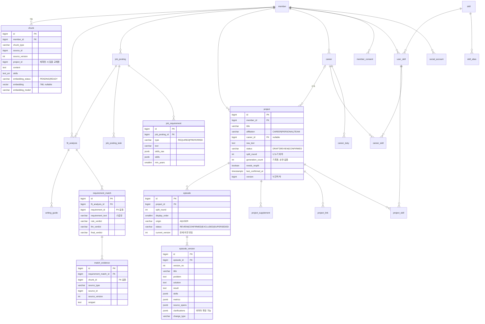

# 03. 테이블 설계

> 실제 DDL: [`V1__init_schema.sql`](../src/main/resources/db/migration/V1__init_schema.sql), 기술 사전 시드: [`V2__seed_skill_catalog.sql`](../src/main/resources/db/migration/V2__seed_skill_catalog.sql)
> 로컬 PostgreSQL 16에서 두 마이그레이션 적용, CHECK·유니크 제약, 탈퇴 연쇄 삭제를 확인했습니다. (pgvector `vector` 타입은 테스트 환경에 확장이 없어 `real[]`로 바꿔 확인 → 실제 확인은 `./gradlew test`의 Testcontainers 테스트가 한다.)

## 1. 전체 구조

- 스키마 2개: **`app`**(원본) 24개 테이블, **`rag`**(검색용) 1개 테이블. 마이그레이션 기록은 `app.flyway_schema_history`.
- 애그리거트 하나 = 루트 테이블 하나 + 그 안의 자식 테이블들. 아래 ERD는 애그리거트 경계(점선 상자 대신 색 구분은 생략)와 주요 컬럼만 보여줍니다.



## 2. 테이블 목록

| 모듈 | 테이블 | 무엇 | 애그리거트 |
| --- | --- | --- | --- |
| member | `member` | 회원 (이메일은 대소문자 무시 유니크) | Member (루트) |
| member | `social_account` | 소셜 로그인 계정 (provider + provider_user_id 유니크) | Member |
| member | `member_consent` | 약관·개인정보 동의 이력 (버전별) | Member |
| skill | `skill` | 표준 기술 (name_key 유니크, 자동완성용 trigram 인덱스) | Skill (루트) |
| skill | `skill_alias` | 별칭 (alias_key 유니크) | Skill |
| skill | `unregistered_skill_name` | 사전에 없던 기술명 기록 (사전 보강용) | — |
| profile | `user_skill` | 기술스택 항목 + 숙련도 1~4 (회원+기술 유니크) | UserSkill (루트) |
| profile | `career` | 경력 | Career (루트) |
| profile | `career_duty` | 주요 업무 줄 (0~4번, 최대 5줄) | Career |
| profile | `career_skill` | 경력에 쓴 기술 (user_skill 참조) | Career |
| project | `project` | 프로젝트 + 원문 + 상태 + 나누기 회차·생성 기록 + 재등록 정보 | **Project (루트)** |
| project | `project_skill` | 프로젝트 사용 기술 | Project |
| project | `project_link` | GitHub·배포 링크 | Project |
| project | `project_supplement` | 확인 질문 답변 (원문 뒤에 붙는다) | Project |
| project | `episode` | 사례 (현재 버전 포인터 + 상태 + 나누기 회차) | Project |
| project | `episode_version` | 사례 버전 내용 (append-only) | Project |
| jd | `job_posting` | 공고 기본 정보 + 회사 소개 | JobPosting (루트) |
| jd | `job_requirement` | 필수·우대 요건 한 줄 + 추출 결과 | JobPosting |
| jd | `job_posting_task` | 주요 업무 한 줄 | JobPosting |
| matching | `fit_analysis` | 적합도 분석 1회 | **FitAnalysis (루트)** |
| matching | `requirement_match` | 요건별 판정 (요건 스냅샷 포함) | FitAnalysis |
| matching | `match_evidence` | 판정 근거 (청크 + 원본 출처) | FitAnalysis |
| guide | `writing_guide` | 탭별 작성 방향 (생성 번호별 이력) | WritingGuide (루트) |
| (공통) | `ai_call_log` | AI 호출 기록: 모델, 프롬프트 버전, 지연, 성공 여부 | — |
| rag | `rag.chunk` | 검색 청크 + 벡터 + 메타데이터 | — (읽기 모델) |

## 3. 설계 결정과 이유

### 3.1 기본 규칙

| 결정 | 이유 |
| --- | --- |
| PK는 `bigint GENERATED BY DEFAULT AS IDENTITY` | JPA `GenerationType.IDENTITY`와 바로 맞는다. UUID보다 단순하고 인덱스가 작다. 순번이 노출되는 문제는 모든 조회의 `member_id` 소유권 검사로 막는다. |
| enum은 `varchar` + `CHECK` | PostgreSQL enum 타입은 값 추가가 번거롭다. Java enum 이름과 CHECK 값을 똑같이 맞춘다 (`@Enumerated(EnumType.STRING)`). |
| 시간은 `timestamptz` ↔ Java `Instant` | 서버·DB 시간대가 달라도 안전하다. 화면 표시용 변환(KST)은 웹이 한다. |
| 월 단위(YYYY-MM)는 `date`(그 달 1일) + CHECK | 기간 계산(개월 수, 겹침)을 SQL·Java 모두 쉽게. `YearMonth` ↔ `date` 변환기를 하나 만든다. |
| 루트 테이블에 `version` 컬럼 (`career`, `project`, `job_posting`) | 낙관적 락(`@Version`). 자동 저장이 잦은 화면(S03·S04·S07)에서 덮어쓰기를 막는다. |
| 테이블 이름은 단수, 컬럼은 snake_case | Hibernate 기본 명명 전략이 `camelCase` 필드를 `snake_case` 컬럼으로 바꿔 준다 (`generationCount` → `generation_count`). |

### 3.2 목록을 저장하는 네 가지 방법과 고르는 기준

같은 "목록"이라도 쓰임에 따라 저장 방법을 다르게 골랐습니다. 이 기준표가 이 설계의 핵심입니다.

| 방법 | 언제 | 이 설계에서 | JPA 매핑 |
| --- | --- | --- | --- |
| 자식 **엔티티** 테이블 (자기 id 있음) | 다른 곳에서 ID로 가리키거나, 상태·행동이 있을 때 | `episode`, `job_requirement`, `requirement_match` | `@OneToMany(cascade=ALL, orphanRemoval=true)` |
| **값 컬렉션** 테이블 (복합 PK, id 없음) | 사용자가 편집하는 단순한 줄 목록 | `career_duty`, `project_link`, `job_posting_task`, `career_skill`, `project_skill` | `@ElementCollection` + `@OrderColumn` |
| **jsonb** 컬럼 | AI가 만든, 통째로 읽고 쓰는 구조 데이터. 안을 조건으로 검색하지 않음 | `metrics`, `source_spans`, `clarifications`, `skills_raw`, 작성 방향 `content` | `@JdbcTypeCode(SqlTypes.JSON)` |
| **배열**(`text[]`) 컬럼 | 검색 조건으로 겹침(`&&`) 연산을 써야 할 때 | `rag.chunk.skills` | JdbcClient (SQL) |

### 3.3 사례 버전: 포인터 + 이력 테이블

기획서 4.3은 "버전은 사례마다 올라가고 이전 버전은 별도 이력 테이블에 보관"이라고 합니다. 두 가지 방법 중 **B**를 골랐습니다.

| | A. `episode`에 현재 내용, 이력 테이블에 과거 내용 | **B. 모든 내용은 `episode_version`, `episode`는 현재 버전 번호만** |
| --- | --- | --- |
| 새 버전 | 현재 내용을 이력으로 복사 → 현재 내용 덮어쓰기 | 버전 행 하나 추가 → 포인터 이동 |
| 되돌리기 | 이력에서 현재로 다시 복사 | 포인터만 이동 |
| 같은 내용이 두 곳에 | 있음 | 없음 |

B는 버전 행을 한 번 쓰면 고치지 않으므로(append-only) "AI가 무엇을 만들었고 사용자가 무엇을 고쳤는지"가 그대로 남습니다. KPI(2회 이내 확정 비율)도 `version_no`와 `change_type`으로 바로 계산됩니다.

### 3.4 원문과 보충 답변을 나눈 이유

기획서는 "확인 질문의 답을 원문에 덧붙여 보관"이라고 합니다. 원문 컬럼에 직접 이어 쓰면 사용자가 쓴 원문과 답변이 섞여 구분할 수 없게 됩니다. 그래서 `project.raw_text`는 사용자가 쓴 그대로 두고, 답변은 `project_supplement`에 순서대로 쌓은 뒤 AI에 보낼 때 `원문 + 답변들`로 이어 붙입니다. **뒤에만 붙이므로** 이전에 받은 `source_spans` 위치는 바뀌지 않습니다.

### 3.5 공고는 DB가 아니라 도메인이 검증한다

S07은 입력 중 자동 임시 저장을 하고, 검증 메시지는 "분석하기"를 누른 뒤부터 보여줍니다. 그래서 임시 저장 단계에서는 150자를 넘는 줄, 빈 회사명도 저장되어야 합니다. 이런 이유로 `job_requirement.text`는 `varchar(1000)`, `company_name`은 빈 문자열 기본값이고, 150자·필수 항목 규칙은 `JobPosting.validateForAnalysis()`가 검사합니다.

### 3.6 분석 결과는 스냅샷, 근거 청크에는 FK를 걸지 않는다

- `requirement_match.requirement_text`는 분석 시점의 요건 문구 복사본입니다. 사용자가 요건을 고치고 다시 분석해도(기획서 8장) 이전 리포트는 그대로입니다. 그래서 `requirement_id`에도 FK를 걸지 않았습니다.
- `match_evidence.chunk_id`에 FK를 걸지 않은 이유: 경험을 수정하면 이전 버전 청크는 삭제됩니다(F3). FK가 있으면 청크 삭제가 막히거나 결과가 같이 지워집니다. 대신 원본 출처(`source_type`, `source_id`, `source_version`)와 근거 문장(`snippet`)을 함께 저장해, "근거 경험 카드 클릭 시 원본"(S08)으로 갈 수 있게 했습니다.

### 3.7 삭제 정책

| 상황 | DB | 애플리케이션 |
| --- | --- | --- |
| 회원 탈퇴 | `member` 삭제 → 모든 테이블 `ON DELETE CASCADE` (로컬에서 남는 행 0개 확인) | Redis 캐시 삭제 |
| 기술스택에서 기술 삭제 | `career_skill`, `project_skill` 연결도 CASCADE | **삭제 전에 사용 중인지 검사하고 막는다** (02 문서 Q7) |
| 경력 삭제 | `project.career_id` → `SET NULL` | **삭제 전에 연결된 프로젝트를 검사** (Q8) |
| 사례 다시 나누기 | 삭제하지 않음 (`status = SUPERSEDED`, `split_round`로 회차 구분) | 화면·청크에서 제외. 재등록 맥락·추후 회차 비교에 사용 |
| 재등록 후 다시 확정 | `rag.chunk`에서 그 `project_id`의 청크를 지우고 새로 등록 | 다시 확정 전까지는 이전 청크를 그대로 검색에 사용 |

처음에는 경력·프로젝트 → 기술스택 FK를 기본값(NO ACTION)으로 두었는데, 로컬 검증에서 **탈퇴(member 삭제) 자체가 실패**했습니다. 연쇄 삭제 순서상 `user_skill`이 `career_skill`보다 먼저 지워지려 했기 때문입니다. 그래서 DB는 연쇄 삭제를 허용하고, "지워도 되는지"는 서비스가 판단하는 쪽으로 정했습니다.

### 3.8 `rag.chunk` — 벡터와 하이브리드 검색

| 결정 | 이유 |
| --- | --- |
| `embedding public.vector(768)` | embeddinggemma-2 기준 768차원 (ADR-0001, 기획서 v1.9 5.3). `embedding_model`에 revision과 차원을 함께 기록한다(예: `google/embeddinggemma-2@<rev>:768`). ADR-0001은 아직 "제안" 상태이고 묶음 1이 끝나기 전에 확정한다. 모델이 바뀌면 새 마이그레이션 + 전체 재임베딩. |
| `embedding_status` (`PENDING`/`READY`) + 벡터 nullable | GPU 서버는 쓸 때만 켜므로(ADR-0001), 꺼져 있을 때 확정한 사례는 벡터 없이 `PENDING`으로 저장하고 GPU가 켜지면 다시 처리한다 (기획서 8장). CHECK 제약으로 `READY`면 벡터가 반드시 있게 했다. |
| `project_id` (episode·project_summary 청크) | 재등록한 프로젝트를 다시 확정하면 그 프로젝트의 청크를 통째로 바꾸므로 (ADR-0002), 프로젝트 단위로 찾을 수 있어야 한다. |
| HNSW 같은 벡터 인덱스는 **아직 만들지 않음** | 모든 검색이 `member_id`로 먼저 좁혀지고, 회원당 청크는 수백 개(기획서 5.3). 수백 개는 정확한 거리 계산이 충분히 빠르고 결과도 정확하다. 근사 인덱스는 필터와 함께 쓰면 결과가 빠지는 문제도 있다. |
| `skills text[]` + GIN 인덱스 | 키워드 검색의 핵심: 정규화된 기술명이 겹치는 청크 (`skills && ARRAY['Kafka']`). |
| `content` trigram 인덱스 | 한국어는 PostgreSQL 기본 전문 검색이 형태소를 나누지 못하므로, 부분 문자열 유사도(pg_trgm)로 보완. |
| 유니크 `(member_id, chunk_type, source_id, source_version)` | 같은 출처·버전 청크 중복 방지. 재등록은 "새 버전 저장 → 이전 버전 삭제"를 한 트랜잭션에서 (F3). |
| `rag` → `app.member` FK | 스키마가 달라도 FK는 걸 수 있다. 탈퇴 시 벡터도 즉시 삭제 (기획서 8장). |

하이브리드 검색 SQL의 출발점 (튜닝 대상, `rag` 모듈의 한 클래스에만 둡니다):

```sql
WITH vec AS (           -- 의미 유사도 상위 20
    SELECT id, 1 - (embedding <=> :queryVector) AS score
    FROM rag.chunk
    WHERE member_id = :memberId                 -- 항상 필수
      AND embedding_status = 'READY'
    ORDER BY embedding <=> :queryVector
    LIMIT 20
), kw AS (              -- 정규화된 기술명이 겹치는 청크
    SELECT id, 1.0 AS score
    FROM rag.chunk
    WHERE member_id = :memberId
      AND skills && :requirementSkills
    LIMIT 20
)
SELECT c.id, c.chunk_type, c.source_id, c.source_version, c.content,
       COALESCE(v.score, 0) * 0.7 + COALESCE(k.score, 0) * 0.3 AS score
FROM (SELECT id FROM vec UNION SELECT id FROM kw) ids
JOIN rag.chunk c ON c.id = ids.id
LEFT JOIN vec v ON v.id = c.id
LEFT JOIN kw  k ON k.id = c.id
ORDER BY score DESC
LIMIT 20;
```

가중치(0.7 / 0.3)는 임시값입니다. AI 담당의 평가 세트(`evals/`)로 매칭 정확도(85%)를 보면서 조정하고, 점수 합산 대신 순위 기반 합산(RRF)도 비교해 볼 만합니다.

## 4. 기획서 4.3 JSON ↔ 테이블 대응

| 기획서 필드 | 저장 위치 |
| --- | --- |
| `project_id`, `title`, `period`, `career_id`, `status`, `generation_count` | `project` |
| `skills` (프로젝트) | `project_skill` → `user_skill` → `skill.name` |
| `raw_text` | `project.raw_text` (+ 답변은 `project_supplement`) |
| `episodes[].episode_id`, `status`, `version` | `episode.id`, `episode.status`, `episode.current_version` |
| `episodes[].title`, `role`, `problem`, `solution`, `result` | `episode_version` (현재 버전 행) |
| `episodes[].skills`, `metrics`, `source_spans`, `unverified` | `episode_version.skills`, `metrics`, `source_spans`, `clarifications` (jsonb) |

## 5. 앞으로 바꿀 때의 규칙 (Flyway)

- **이미 적용한 마이그레이션 파일은 절대 고치지 않는다.** 바꿀 것이 있으면 `V3__설명.sql` 새 파일을 추가한다. 고치면 체크섬 오류로 앱이 뜨지 않는다.
- 예외: 아직 아무도 적용하지 않은 지금(첫 커밋 전)은 V1을 자유롭게 고쳐도 된다. 팀이 V1을 받아 간 뒤부터 위 규칙을 지킨다.
- 엔티티를 추가·수정하면 `ddl-auto: validate`가 테이블과 맞는지 앱 시작 때 검사한다. 맞지 않으면 앱이 뜨지 않으니, 오류 메시지의 테이블·컬럼 이름을 보고 엔티티나 마이그레이션을 고친다.
