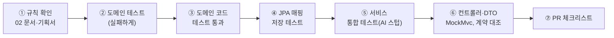

# 04. 개발 계획

> `작업목록.md`의 BE 작업(BE-01~17)과 로드맵(0~8주)을 기준으로, **Java·Spring을 처음 쓰는 1인 백엔드**가 따라갈 순서로 다시 짰습니다.

## 1. 전체 일정

| 주차 | 단계 | 목표 | 작업목록 ID | 끝났다는 기준 |
| --- | --- | --- | --- | --- |
| 0주차 | 준비 | 개발 환경, Java·Spring·JPA 기초, 이 설계 리뷰 | — | 로컬에서 앱·테스트가 돌고, 아래 "0주차 점검 질문"에 답할 수 있다 |
| 1주차 | 0단계 기반 | 설계 확정·계약 초안, 공통 기반 코드 | BE-01 ✅, BE-02 ✅(초안), C-02~C-04, C-06 | 02 문서 결정 항목 합의·ADR, `web-api`·`api-ai` 계약 v0.1 초안 |
| 2주차 | 0단계 기반 + 연습 | **쉬운 애그리거트로 패턴 연습**: 기술 사전, 기술스택, 경력 | BE-04, BE-05, BE-06 | 기술 자동완성·정규화 API, 기술스택·경력 CRUD, AI 스텁 클라이언트 |
| 3~4주차 | 묶음 1 | 프로젝트 입력 → 사례 나누기 → 사례별 확정 → RAG 저장 | BE-07~10, BE-18(AI 작업 상태) | 실제 AI로 사례 N개 생성, 확정한 사례만 벡터 저장 (G1 이후) |
| 5~6주차 | 묶음 2 | JD 입력 → 적합도 리포트, 공고 목록 | BE-11~13, BE-18(공고 목록) | 요건별 판정과 근거 링크가 API로 나온다 |
| 7~8주차 | 묶음 3 | 작성 방향 탭 5개 (탭별 생성 작업) | BE-14, BE-15 | 방향성 생성, 인용 출처 검증 통과 |
| 7~8주차 | 묶음 4 (병행) | 로그인, 탈퇴, 라이브러리 | BE-03 | 온보딩 전체 연결 |
| 8주차 | 마무리 | 보안·계약 테스트·모듈 경계 테스트 | BE-16, BE-17 | G2 출시 준비 |

**작업목록과 다른 점 하나:** 작업목록은 묶음 1에서 기술·경력을 `fixtures/`로 넣어 두고 실제 화면 API는 묶음 4에서 만듭니다. 이 계획은 **기술스택·경력 CRUD(BE-04, BE-06)를 2주차로 당깁니다.** 규칙이 단순한 애그리거트로 엔티티·리포지토리·서비스·컨트롤러·테스트의 한 바퀴를 먼저 연습해 두면, 규칙이 많은 Project 애그리거트(묶음 1)에서 막히는 일이 줄고, 묶음 4가 가벼워져 묶음 3과 병행하기 쉬워집니다. 프론트 담당에게도 S02·S03 API를 일찍 줄 수 있습니다. → 팀과 합의 필요.

**로그인 전 개발 방법:** 인증(BE-03)은 묶음 4라서, 그 전까지는 컨트롤러가 `@CurrentMemberId Long memberId` 같은 파라미터로 회원 ID를 받게 만들고, `local` 프로필에서만 `X-Member-Id` 요청 헤더로 값을 채우는 구현을 둡니다. 묶음 4에서 이 구현만 Spring Security 세션 기반으로 바꾸면 컨트롤러는 고칠 것이 없습니다. (헤더 방식이 `local` 밖에서 켜지지 않도록 `@Profile("local")`로 막고 테스트로 확인할 것.)

## 2. 0주차 — 환경과 기초 (약 5일)

[05 로컬 환경 셋업](05-로컬-환경-셋업.md)부터 끝낸 뒤 시작합니다. 다른 언어로 백엔드를 해 봤다는 전제로, **이 프로젝트에 필요한 것만** 골랐습니다.

| 일 | 주제 | 꼭 알아야 할 것 | 이 레포에서 해볼 것 |
| --- | --- | --- | --- |
| 1 | Java 문법 | 클래스·인터페이스·접근 제어자(`private`/package-private/`public`), `record`, `enum`(필드·메서드 가진 enum), `List`/`Set`/`Map`, `Optional`, `stream`, 예외(`RuntimeException` 계열), `equals`/`hashCode` | `SkillNameKey`와 테스트를 읽고, 규칙(예: 하이픈 제거) 하나를 바꿔 테스트를 깨뜨렸다 고쳐 보기 |
| 2 | Spring 핵심 | 빈(Bean)과 의존성 주입(생성자 주입), `@Service`/`@Component`/`@Configuration`, `application.yml`과 프로필, **`@Transactional`은 프록시로 동작한다**(같은 클래스 안의 메서드 호출에는 적용 안 됨) | `GlobalExceptionHandler`가 어떻게 모든 컨트롤러에 적용되는지 따라가 보기 |
| 3 | Spring MVC | `@RestController`, `@RequestBody` + `@Valid`, 응답 DTO(`record`), `ProblemDetail` 오류 응답, MockMvc 테스트 | 연습용 `GET /api/skills?query=spr` 를 만들어 보기 (2주차 BE-04의 시작) |
| 4 | JPA ① | 영속성 컨텍스트, **변경 감지**(조회한 엔티티의 값을 바꾸면 `save()` 없이 UPDATE), 지연 로딩, `@Enumerated(STRING)`, `@Embeddable` | `Skill`, `SkillAlias` 엔티티를 V1 테이블에 맞춰 만들고 앱을 띄워 `validate` 통과시키기 |
| 5 | JPA ② | 연관관계 주인(`mappedBy`), `cascade`·`orphanRemoval`, `@ElementCollection`, `@Version`, N+1과 해결법, Testcontainers 저장 테스트 | `Career` + `career_duty`(`@ElementCollection`) 매핑과 저장 테스트 |

**추천 자료** (하나만 고르라면 굵게)
- **Spring 공식 가이드** <https://spring.io/guides> — "Building a RESTful Web Service", "Accessing Data with JPA"
- Spring Boot 레퍼런스 <https://docs.spring.io/spring-boot/>, Spring Data JPA 레퍼런스 <https://docs.spring.io/spring-data/jpa/reference/>
- 책: 『**자바 ORM 표준 JPA 프로그래밍**』(김영한) — 영속성 컨텍스트·연관관계 장 / 『**도메인 주도 개발 시작하기**』(최범균) — 애그리거트·리포지토리 장. 둘 다 이 문서의 설계 방식과 같은 방향.

**0주차 점검 질문** — 말로 설명할 수 있으면 다음 단계로:
1. `@Transactional` 메서드 안에서 엔티티의 필드를 바꾸면 왜 UPDATE가 나가나?
2. 컨트롤러에서 엔티티의 지연 로딩 컬렉션에 접근하면 왜 오류가 나나? (`open-in-view: false`)
3. `Project`가 `Career` 객체 대신 `careerId`를 가지는 이유는?
4. AI 호출을 `@Transactional` 메서드 안에서 하면 무슨 일이 생기나?

## 3. 기능 하나를 만드는 순서 (모든 묶음 공통)

- ②~③은 Spring을 띄우지 않으므로 빠르다. 규칙이 많은 곳일수록 여기서 시간을 쓴다.
- ⑥의 요청·응답 모양은 `nerdnam-docs/contracts/web-api.openapi.yaml`과 똑같이 맞춘다. 계약에 없으면 계약 PR부터.

**PR 체크리스트**

- [ ] `@Setter`/`@Data` 없음. 상태 변경은 의미 있는 메서드로
- [ ] 다른 모듈의 리포지토리·엔티티를 직접 쓰지 않음 (ID 참조, 상대 모듈 서비스 호출, 이벤트)
- [ ] 모든 조회·수정에 `memberId` 소유권 확인
- [ ] AI 호출이 트랜잭션 안에 있지 않음
- [ ] 이미 적용된 Flyway 파일을 고치지 않음 (새 `V{n}__` 파일)
- [ ] 도메인 규칙마다 단위 테스트, 리포지토리마다 저장 테스트
- [ ] 응답에 엔티티를 그대로 내보내지 않음

## 4. 단계별 상세

### 1주차 — 설계 확정과 기반

| 작업 | 내용 | 결과물 |
| --- | --- | --- |
| 설계 리뷰 | 01~03 문서를 기획·프론트·AI 담당과 함께 읽기. 도메인 규칙(Q1~Q10, D-2·3·5)은 **결정 완료**(ADR-0002, 기획서 v1.10). 남은 것: 재등록 취소 여부, 패키지 이름 변경, ADR-0001(임베딩 768차원) 확정 | 패키지 이름 변경 ADR, 기획서 5.2 반영 |
| 계약 초안 (C-02~C-04) | FE가 만든 `contracts/화면별-API-목록.md`의 **엔드포인트 칸을 BE가 채우고**, "확인할 것" 중 BE 몫은 02 문서 8장의 초안 답으로 FE와 합의 → `web-api.openapi.yaml`; `/restructure` 등 5개 → `api-ai.openapi.yaml`. **임베딩 모델·차원(ADR-0001 제안: embeddinggemma-2, 768)·타임아웃·오류 코드(D-7)** 를 AI 담당과 확정 | 계약 v0.1 |
| BE-02 마무리 | 결정 결과를 V1에 반영 (첫 커밋 전이면 V1 수정 가능) | V1 확정, 이후 수정은 V3부터 |
| 공통 코드 ✅ | `@CurrentMemberId` + local 헤더 구현, `YearMonth` 변환기, 소유권 조회 패턴 예시 | `common` 패키지 |
| C-06 | 이 레포의 `compose.yaml`을 팀 전체 환경(web·ai 포함)으로 확장할지 결정 | — |

### 2주차 — 쉬운 애그리거트로 연습 (BE-04, BE-05, BE-06)

> **진행 상황 (2026-10-22): 완료** — `feat/profile-skill-catalog`. 테스트 50개 통과(도메인 단위 19, AI 클라이언트 8, API 통합 23).
> - 공통: `@CurrentMemberId`(local 은 `X-Member-Id` 헤더), `YearMonthConverter`, 소유권 조회(`findByIdAndMemberId`), local 시드 회원(1번)
> - API: `GET /api/skills`, `GET/POST/PATCH/DELETE /api/me/skills`, `GET/POST/PUT/DELETE /api/me/careers`
> - 계획과 달라진 점: 자동완성은 표준 기술만 보여준다(사용자 추가 기술은 본인 기술스택에 이미 있으므로). Q8(경력 삭제)도 여기서 함께 구현. "다른 모듈의 프로젝트 조회"는 profile 의 `ProjectReferences` 포트를 project 가 구현하는 방식(순환 의존 방지).
> - 남은 것: 기술·경력 변경 시 RAG 청크 재등록 이벤트(BE-10과 함께), JSON 값 이름(대문자 enum ↔ 계약 소문자)은 C-03 계약 확정 때 맞춤

| 순서 | 작업 | 배우는 패턴 |
| --- | --- | --- |
| 1 | `Skill`·`SkillAlias` 엔티티, `SkillNormalizer`, 자동완성 API (`OFFICIAL` + 내가 추가한 기술) | 값 객체, 도메인 서비스, 조회 전용 서비스(`readOnly`) |
| 2 | `UserSkill` CRUD, 새 기술 추가 시 `USER_ADDED` 사전 등록 + `LEARNING`으로 기술스택 추가 | 작은 애그리거트, 유니크 제약 오류 처리 |
| 3 | `Career` CRUD (`EmploymentPeriod`, 주요 업무 5줄, 사용 기술) | `@Embeddable`, `@ElementCollection`, `@Version` |
| 4 | 기술 삭제 시 사용 중 검사 (Q7) | 모듈 안 서비스 간 협력 |
| 5 | BE-05: `infra.ai` 클라이언트 골격 — Spring `RestClient`, 타임아웃, 재시도 1회, **스텁 구현**(fixtures 고정 응답, `local` 프로필 기본) | 포트와 어댑터, 부패 방지 계층 |

### 3~4주차 — 묶음 1: 프로젝트·사례·RAG 등록 (BE-07~10)

> **진행 상황 (2026-10-22): 완료 (AI 는 스텁)** — `feat/project-restructure-rag`.
> - `Project` 애그리거트와 불변식 P1~P9, 검토 결과 버리기, 재등록. jsonb 왕복은 Jackson 3 + Hibernate 7 기본 설정으로 동작(추가 설정 없음)
> - (2026-10-23 추가, 기획서 v1.17) **읽기 모드**: 확정한 프로젝트의 `GET /review` 는 확정한 사례만 돌려준다(제외한 사례는 빠진다). 변경 API 는 모두 422, 검토 결과 버리기는 아무 일도 하지 않는다. 사례 생성 평가는 확정 뒤에도 보고 바꿀 수 있다
> - `AiJob`: 접수 → 작업 스레드 → 반영, 동시 1건 409(+ `runningJobId`), 오래 멈춘 작업 정리, `GET /api/ai-jobs/{id}`
> - RAG: 같은 트랜잭션에서 청크 텍스트 맞추기(PENDING) → 커밋 뒤 임베딩(READY), 실패 시 5분마다 재시도. **Modulith 이벤트 발행 기록은 쓰지 않았다** (01 문서 8장)
> - 모듈 경계 테스트: Modulith 대신 import 검사(`ModuleBoundaryTest`)
> - 남은 것: 9번 실제 AI 서버 연결(G1 후, 계약 C-04 → 06 문서 초안), ADR-0001 임베딩 차원 확정

| 순서 | 작업 | 주의 |
| --- | --- | --- |
| 1 | `Project` 도메인 + 테스트: 불변식 P1~P9 하나에 테스트 하나 이상 | 02 문서 3장의 코드 스케치에서 시작 |
| 2 | 매핑 + 저장 테스트: `episode_version`의 jsonb(`metrics`, `source_spans`, `clarifications`) 왕복 | Jackson 3 + Hibernate 7 JSON 매핑을 **여기서 처음 확인** |
| 3 | BE-07 임시 저장 API | 자동 저장이 잦으므로 `@Version` 충돌 시 409 처리 |
| 4 | BE-18 앞부분: `AiJob`(접수·완료·실패), 작업 상태 조회 API, `@Async` 실행기, 오래 멈춘 작업 정리 | 묶음 1~3이 모두 이 구조를 쓰므로 먼저 만든다. 동시 1건은 `uk_ai_job_running` 유니크 위반 → 409 |
| 5 | BE-08 `RestructureService` (나누기·다시 나누기·수정 요청·답변, 횟수 제한 없음) | 01 문서 7장의 "접수 → 별도 스레드 AI 호출 → 반영". 재등록이면 이전 확정 사례를 AI에 맥락으로 |
| 6 | BE-09 사례 결정 API (확정·제외·다시 검토하기·편집·추가·이 버전으로 바꾸기·프로젝트 확정·재등록 시작) | 서비스는 "불러오기 → 메서드 호출"만. 확정 전 검토 결과 버리기 API(`discardReview`, 기획서 v1.14 F2) |
| 7 | BE-10 RAG 등록: `ProjectConfirmed` → 그 프로젝트 청크 삭제 → 청크 텍스트 → `/embed` → `rag.chunk` 저장 (`JdbcClient`). GPU가 꺼져 있으면 `PENDING` 저장 후 재처리 작업 | **Spring Modulith 이벤트 발행 기록**으로 실패 재시도 (01 문서 8장). 기술·경력 변경 이벤트도 여기서 |
| 8 | 모듈 경계 테스트 (`ApplicationModules.verify()`) 추가 | 위반이 나오면 지금 고치는 것이 가장 싸다 |
| 9 | 실제 AI 서버 연결 (G1 통과 후) | 계약 테스트로 응답 모양 확인 |

### 5~6주차 — 묶음 2: JD → 적합도 리포트 (BE-11~13)

> **진행 상황 (2026-10-22): 완료 (AI 는 스텁)** — 같은 브랜치.
> - 공고 임시 저장·분석 전 검사(400 + `violations`), 분석 파이프라인(추출 → 정규화 → 임베딩 → 하이브리드 검색 → 연차 규칙 → `/match` → `/gap-guide`), 리포트(한 줄 진단 규칙), 공고 목록(S10, 상태 계산)
> - 남은 것: 7번 SSE 스파이크는 `RestClient`로 본문을 끝까지 받아 SSE 를 해석하는 방식으로 정했다(`ServerSentEvents`). 실제 AI 서버로 20초 목표 측정, 검색 가중치 조정(evals)
> - **확인 필요(2026-10-23):** 근거 사례의 프로젝트가 **재등록 중**이면 S05 읽기 모드로 보낼 곳이 없다 (기획서 v1.17 S08 + ADR-0002 재등록 3). 02 문서 8장 "S08 2 (재등록 중)" 참고 — FE·기획과 정해야 한다
> - (2026-10-23 추가, 기획서 v1.20) AI 서버 입력 규칙을 부르기 전에 막는다: `/gap-guide` 는 미충족·부분 충족만(이미 그랬음), 목록 입력은 1개 이상(필수 요건 1개 이상 검증으로 보장)

| 순서 | 작업 | 주의 |
| --- | --- | --- |
| 1 | `JobPosting` + `validateForAnalysis()` (S07 메시지 표 그대로) | 임시 저장은 검증 없이 |
| 2 | `ExperienceYearsCalculator`(재직기간 합집합), `VerdictPolicy`(낮은 쪽) | 순수 도메인 → 테스트하기 가장 좋은 곳 |
| 3 | 하이브리드 검색 SQL (03 문서 3.8) + `memberId` 필수 시그니처 | 다른 회원 데이터가 절대 안 나오는지 테스트 |
| 4 | `FitAnalysisService`: 추출 → 정규화 → 임베딩 → 검색 → 규칙 판정 → `/match` → 결합 → `/gap-guide`(미충족·부분 충족만) → 저장 | 요건은 묶어서(batch) 호출. 전체 20초 목표. `/gap-guide` 실패는 분석 실패가 아니다 → 기본 문구로 저장 (ADR-0003) |
| 5 | 리포트 API: 충족률·한 줄 진단·요건별 판정·근거 카드·갭 대응 가이드 | 근거 청크 소유권 재확인. 한 줄 진단은 `FitReport.diagnosis()` 규칙 + 단위 테스트 (ADR-0003) |
| 6 | BE-18 뒷부분: 공고 목록 API (`/apply`, 상태는 최근 분석에서 계산) | S10 디자인·MVP 포함 여부는 팀 합의 필요 (기획서 v1.11 제안) |
| 7 | **AI 서버 스트림 읽기 검증(스파이크)** — 묶음 3 대비 | 웹으로는 중계하지 않는다(기획서 v1.11). API가 `/guide`의 SSE 응답을 끝까지 받아 모으는 방법(RestClient 스트림 vs WebClient)만 정한다 |

### 7~8주차 — 묶음 3·4와 마무리

> **진행 상황 (2026-10-22)**
> - 묶음 3 (BE-14): **완료** — 탭별 생성 작업(`lock_scope` = 탭), 다시 만들기, 인용 청크 소유권, 포트폴리오 `order`·`kind` 후처리. 만족도 평가(기획서 4.6, V3)도 추가
>   - (2026-10-23, 기획서 v1.20) AI 서버에 보내는 `tab` 값을 웹 주소와 같은 이름으로 바꿨다: `motive`·`intro`·`portfolio`·`career`·`image` (`GuideTab.aiName()`)
> - 묶음 4 (BE-03): **완료** — Google·카카오 OAuth2 로그인, 쿠키 세션 + CSRF, 동의 기록, 탈퇴, 내 정보·온보딩 상태·라이브러리 API
>   - (2026-10-23) **세션 저장소를 Redis 로** 옮겼다 (`spring-boot-starter-session-data-redis`). 키 `nerdnam:session:sessions:{id}`, 7일. 앱을 재시작해도 로그인이 유지되고 서버가 2대가 돼도 된다. 테스트는 Redis 컨테이너를 띄워 실제로 확인한다(`RedisSessionStoreTest`). Redis 리포지토리 기능은 꺼 뒀다(부팅 로그 잡음)
> - **남은 것:** Redis 결과 캐시(아래 "결과 캐시는 무엇을 캐시할까"), 이메일 로그인(S01 확인할 것 1), 계약 테스트 CI(BE-16·17), 개인정보 암호화 범위, 실제 AI 서버 연결

#### 결과 캐시는 무엇을 캐시할까 (2026-10-23, 결정 필요)

처음 계획은 "같은 공고·같은 경험 버전이면 결과를 재사용"이었는데, 그 뒤에 정해진 것들과 부딪친다.

| 원래 기대 | 지금 상황 |
| --- | --- |
| 다시 들어왔을 때 저장된 결과를 바로 준다 (C-02 S09 1) | 이미 그렇다. 리포트·탭 결과는 DB(`fit_analysis`, `writing_guide`)에 있어 캐시가 없어도 즉시 준다 |
| 같은 공고를 다시 분석하면 재사용한다 | BE 초안 답은 "덮어쓰지 않고 분석을 **새로 쌓는다**"(02 문서 8장 S07 6). 재사용해 버리면 "분석일"이 안 바뀌어 화면과 어긋난다 |
| 같은 탭을 다시 만들면 재사용한다 | FE 제안(2026-10-23)대로 "다시 만들기"에 피드백이 필수가 되면 매번 입력이 달라 캐시가 맞을 일이 거의 없다 |

**BE 제안:** 화면에 보이는 "결과" 대신 **AI 호출 단계**를 입력 해시로 캐시한다. 분석 행은 그대로 새로 쌓고, 안에서 같은 입력의 AI 호출만 건너뛴다. 득이 확실한 곳은 **실패 후 다시 시도**다 — `/requirements/extract` 는 성공했는데 `/match` 에서 GPU 가 꺼져 실패하면, 다시 시도할 때 성공한 단계를 또 부르지 않는다. 뜻이 분명한(같은 입력 → 같은 출력) `/embed`(query)·`/requirements/extract` 만 먼저 캐시하고, 판정·생성(`/match`·`/gap-guide`·`/guide`)은 캐시하지 않는다. 자리는 `infra.ai` 의 감싸기 하나(`RecordingAiServerClient` 와 같은 자리)면 된다.

팀과 합의한 뒤 구현한다. 특히 "같은 공고를 다시 분석하면 새로 쌓는가"(S07 6)가 정해지면 범위가 분명해진다.

| 묶음 | 작업 | 주의 |
| --- | --- | --- |
| 3 (BE-14) | `WritingGuide`, 탭별 생성 작업(`AiJob`, `lock_scope` = 탭), 탭 다시 만들기, 인용 청크 소유권 확인, 포트폴리오 `order`·`kind` 후처리 | AI 스트림을 받는 동안 DB 트랜잭션을 열지 않는다. 스트림이 끝난 뒤 저장. 다섯 탭을 한꺼번에 만들지, 열 때 만들지는 FE와 결정 (C-02 S09 1) |
| 3 | Redis 결과 캐시 (같은 공고·같은 경험 버전이면 재사용) | **무엇을 캐시할지 먼저 정해야 한다 (아래)** |
| 4 (BE-03) | Spring Security OAuth2 로그인(Google·카카오, D-8), Redis 세션, 동의 기록, 탈퇴 | `local` 헤더 인증 구현을 교체. 웹(Next.js)과 쿠키 도메인·CORS 설정 확인 |
| 마무리 (BE-16·17) | 계약 테스트 CI, fixtures 통합 테스트, AI 결과의 모델명·프롬프트 버전 저장 확인, 개인정보 암호화 범위 결정 | — |

## 4-1. 미결 사항과 결정 (2026-10-23)

### 해소돼서 반영한 것

SPEC 에서 2026-10-23 에 결정이 쏟아졌습니다. 이슈 12건 중 **9건이 닫혔습니다.**

| 결정 | 어디서 | BE 가 한 일 |
| --- | --- | --- |
| 임베딩 `google/embeddinggemma-2@914f7f8…:768` 확정 | ADR-0001 (AI #3) | 값이 그대로여서 코드 변경 없음. docs/03·06 에 revision 까지 적음 |
| GPU 꺼짐 → 생성 작업은 **바로 실패**(MVP) | ADR-0001 (AI #4) | 이미 그 동작. docs/06 에 결정으로 기록 |
| C-04 계약 v0.1 (`contracts/api-ai.openapi.yaml`) | AI 레포 → SPEC (AI #5) | **계약과 BE 구현을 대조해 다른 곳이 없음을 확인**(docs/06 "계약 대조 결과"). `/guide` 의 `Accept` 를 JSON 하나로 정리 |
| BE 도 같은 EKS 클러스터, Redis 는 클러스터 안 Pod | ADR-0005·D-11 (AI #6) | 주소를 docs/05 에 적음(`ai.nerdnam.svc:8000`, `redis.nerdnam.svc:6379`). Redis Pod 재시작 시 세션 소실을 감수하는 것도 기록 |
| `fixtures/` 생김 | C-05 (AI #7) | BE-16 통합 테스트에서 쓴다 |
| 응답 JSON 값은 **소문자** | D-10 (FE #2) | **구현**: Jackson 전역 설정 + 문자열 값 낮추기 + `JsonValueCaseTest` 로 고정. 오류 코드만 대문자 유지 |
| PDF 는 브라우저 인쇄 | D-6 (FE #3) | **BE-15 없음** |
| 사례 근거의 프로젝트가 재등록 중이면 S06 카드로 | 기획서 v1.25 (FE #4) | BE 변경 없음 (`episodes` 빈 배열 유지). docs/02 8장에 결정 기록 |
| 다시 분석하면 새로 쌓고 이전 분석을 볼 수 있다 | 기획서 v1.25 (FE #5) | **구현**: `GET /api/job-postings/{id}/analyses` (분석 기록) |
| 로그인은 소셜만, 이메일은 MVP 이후 | D-8 (FE #7) | 할 일 없음 (Google·카카오 구현 완료) |
| 포트폴리오 시각자료는 안내만 | D-1 (SPEC #30) | 할 일 없음 (`visual` 을 만들지 않음) |

### 아직 기다리는 것

| 이슈 | 내용 | 막는 BE 작업 |
| --- | --- | --- |
| [FE #6](https://github.com/nerd-nam/FE-nerdnam/issues/6) | S09-4 탭 다시 만들기 피드백을 서버도 막을지 | **BE 제안대로 구현했습니다**(다시 만들 때만 필수, 400). FE 가 반대하면 되돌립니다 |

### BE 가 정한 것 (2026-10-23)

다른 담당의 답이 필요 없는 것들입니다. 제안대로 정했습니다.

| 항목 | 정한 것 |
| --- | --- |
| C-06 로컬 환경 | BE 의 `compose.yaml` 은 **PostgreSQL + Redis 만** 유지한다. 웹·AI 서버는 각자 레포에서 띄우고 `nerdnam.ai.base-url` 로 잇는다 — 레포가 4개로 나뉘어 있어 한 파일로 묶으면 누가 관리할지가 애매해진다 |
| C-05 fixtures | SPEC 에 생겼으니 **BE-16 통합 테스트의 입력으로 쓴다**. 그때까지는 개발용 스텁(`StubAiServerClient`)을 그대로 쓴다 |
| 세션 쿠키 수명 | **지금 동작 유지** — 쿠키는 세션 쿠키라 브라우저를 닫으면 다시 로그인한다(서버 세션은 7일). 경력·공고 같은 민감한 내용을 다루고, 로그인 유지를 원하면 기획·보안과 함께 정할 일이다. ADR-0005 로 Redis Pod 재시작 시에도 다시 로그인하는 것이 확정됐다 |
| S09-4 다시 만들기 | **서버도 피드백을 요구한다**(400). 웹 UI 와 규칙이 같아지고 기획서 v1.12(다시 나누기 피드백 필수)와도 같다 |
| 쌓인 PR | **완료.** #1~#3 은 이미 머지됐지만 스택 구조 때문에 main 에는 #1 만 들어가 있었다. PR #10 으로 전체를 main 에 모으고 기본 브랜치를 `main` 으로 바꿨다. 머지된 브랜치 3개는 지웠다 — 원격 브랜치는 `main` 하나. 앞으로는 main 에서 브랜치를 딴다 |

## 5. 위험과 대응

| 위험 | 신호 | 대응 |
| --- | --- | --- |
| 1인 백엔드에 묶음 3·4가 겹침 | 6주차 끝에 묶음 2가 안 끝남 | 2주차에 프로필 CRUD를 당겨 둔 것이 첫 대응. 그래도 밀리면 로그인은 Google 하나로 먼저 |
| JPA 학습 곡선 | 매핑·지연 로딩 오류로 하루 이상 막힘 | 막힌 코드를 최소 재현 테스트로 만들고 질문. 엔티티 연관관계를 애그리거트 안으로만 제한한 것이 복잡도를 크게 줄여 준다 |
| AI 계약이 자주 바뀜 | 스텁과 실제 응답이 다름 | 계약 태그 고정, `infra.ai`에서만 번역하므로 변경 범위가 한 패키지로 제한됨 |
| 임베딩 모델·차원 미확정 | ADR-0001이 "제안"에서 바뀜 | V1은 ADR-0001 기준 `vector(768)`. 묶음 1 끝(벡터 저장 시작) 전에 확정. 바뀌면 새 마이그레이션 + 전체 재임베딩 |
| 생성 횟수 상한 제거로 AI 호출 증가 | `ai_call_log`에서 프로젝트당·회원당 호출이 튐 | 같은 프로젝트 AI 요청 동시 1건(묶음 1), 회원별 일일 호출량 모니터링. 필요하면 남용 방지용 속도 제한 추가 (ADR-0002) |
| GPU 서버가 꺼져 있을 때 확정 | 임베딩 실패 | 청크를 `PENDING`으로 저장하고 GPU가 켜지면 재처리 (기획서 8장) |
| 커밋 후 이벤트 유실 | 확정했는데 검색에 안 나옴 | 이벤트 발행 기록(Modulith) + `ai_call_log`로 실패 추적 |

## 6. 추후 개발 예정 (MVP 이후)

| 기능 | 내용 | 준비된 것 | 추가로 필요한 것 |
| --- | --- | --- | --- |
| 부분 다시 나누기 | 사례 3개 중 마음에 들지 않는 1개만 다시 만들고 나머지 결정은 유지 | `split_round`, 사례 버전 이력 | `Project`에 선택한 사례만 대체하는 메서드, AI `/restructure` 대상 범위 지정 모드, 화면 |
| 회차 비교 | 기존 사례를 남긴 채 새 사례를 만들어 이전 회차와 나란히 보고 고르기 | `SUPERSEDED` 사례 기록, `split_round` | 회차별 조회 API, "이전 회차 사례 되살리기" 규칙, 화면 |
| 재등록 취소 (검토 필요) | 재등록을 그만두고 이전 확정본으로 돌아가기 | `last_confirmed_at`, 이전 사례 기록 | 범위 결정 (ADR-0002 남은 질문) |

## 7. 이번 주에 할 일 (체크리스트)

- [ ] **이번 변경 받기:** V3 가 추가됐으므로 앱을 띄우면 자동 적용된다. `./gradlew test`(Docker) 또는 `NERDNAM_TEST_USE_LOCAL_DB=true ./gradlew test`
- [ ] AI 담당과 06 문서(AI 계약 초안) 맞추기 → C-04
- [ ] FE 와 README API 목록 맞추기 → C-03 (`web-api.openapi.yaml`)
- [ ] [05 셋업](05-로컬-환경-셋업.md) 따라 JDK 21·Docker·IntelliJ 설치
- [ ] `docker compose up -d` → `./gradlew test` 통과 확인 (`SkillNameKeyTest`, `NerdnamApplicationTests` 두 클래스)
- [ ] `./gradlew bootRun` → `http://localhost:8080/actuator/health` 가 `UP`
- [ ] DB 접속해서 `app`·`rag` 스키마 테이블 26개 눈으로 확인
- [ ] 첫 커밋 & 원격(`nerd-nam/BE-nerdnam`)에 푸시
- [ ] 0주차 학습 1~5일차
- [ ] **로컬 DB 초기화:** V1이 바뀌었으므로 `docker compose down -v && docker compose up -d` 후 `./gradlew test` (안 하면 Flyway 체크섬 오류)
- [ ] 01~03 문서를 팀과 리뷰할 일정 잡기 (도메인 규칙은 ADR-0002로 결정 완료)
